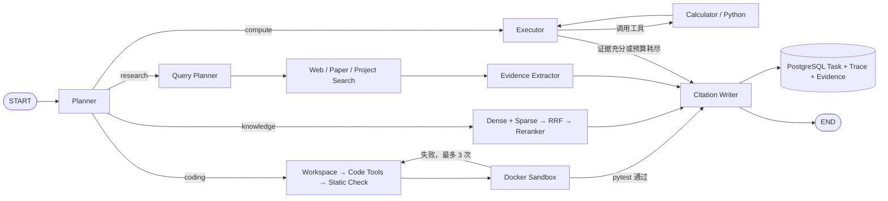

# AutoScholar

> 面向 AI/ML 研究与实验的自主智能体平台  
> Autonomous AI/ML Research & Experiment Agent Platform

AutoScholar 的目标是把复杂研究目标转化为可追踪、可恢复、可评测、可复现的研究流程。当前支持 Web/论文研究、项目知识库、隔离代码执行与 MNIST 实验，已具备持久化自主工作流、MCP 工具平台及本地单操作者 Web 工作台。

## 当前能力

- FastAPI 服务、结构化日志、请求 ID 与统一错误响应
- PostgreSQL、Redis、Docker Compose 与 Alembic 自动迁移
- OpenAI-compatible `LLMProvider`，支持原生 Function Calling
- LangGraph 最小闭环：`Planner → Executor ⇄ Tools → Writer`
- Calculator 安全算术表达式工具
- 受限 Python 子进程工具
- Tavily Web Search 与 Semantic Scholar Paper Search
- Query Planner、Evidence Extractor 与 Citation Writer
- PDF 上传、文本解析、结构感知分块与可恢复后台摄取任务
- Qdrant Dense + BM25 Sparse 检索、RRF 融合与 BGE Reranker
- 独立 RAG Query API 与 Agent `knowledge` 模式
- 本地文档、Web 和论文来源统一进入 Evidence Pool
- Recall@K、HitRate@K、MRR、NDCG RAG Benchmark
- Evidence、Claim-Citation 映射和降级警告持久化
- Agent 任务和 Tool Trace 持久化
- Coding Agent：生成、搜索、读取、原子修改和删除任务源码
- 静态检查、pytest、结构化错误分类和最多 3 次自动修复
- 断网、非 root、限制 CPU/内存/PID/时长的一次性 Docker 沙箱
- 真实 MNIST 只读数据卷与 CPU PyTorch 运行环境
- 同步执行 API 与任务回查 API
- 本地 Web 工作台：项目/PDF 管理、任务提交与实时回放、任务控制和人工审批（9A–9E）

当前 PDF 管线只处理可提取文本的 PDF，不执行 OCR；扫描件和加密 PDF 会明确失败。Web/论文检索仍只使用搜索片段与论文摘要，不自动下载外部全文。

## 工作流



默认预算：最多 6 次执行迭代、4 次工具调用、8 个计划步骤。预算耗尽时，任务状态为 `budget_exceeded`，Writer 会利用已有证据给出带限制说明的部分答案。

## 快速开始

### 环境要求

- Python 3.12
- [`uv`](https://docs.astral.sh/uv/)
- Docker Desktop（包含 Docker Compose）

当前 Windows 开发环境把 Docker Desktop 安装在 `D:\Applications\Docker`，运行数据保存在 `D:\DockerData\wsl`，避免镜像和卷占用系统盘。其他环境可自行选择安装位置。

### 配置模型

```powershell
Copy-Item .env.example .env
```

在本地 `.env` 中填写 OpenAI-compatible 服务：

```dotenv
LLM_BASE_URL=https://your-provider.example/v1
LLM_API_KEY=your-api-key
LLM_MODEL=your-model

TAVILY_API_KEY=your-tavily-api-key
# 可选但推荐；匿名 Semantic Scholar API 也可使用
SEMANTIC_SCHOLAR_API_KEY=your-semantic-scholar-api-key
```

Agent 只使用原生 Function Calling，不提供 JSON Prompt 降级方案。模型至少需要支持 `tools` 和 `tool_choice=auto`；若未返回要求的原生工具调用，任务会明确失败并持久化错误。`.env` 已被 Git 忽略，禁止把任何密钥提交到仓库或粘贴到日志、Issue。

### 使用 Docker 启动

```powershell
docker compose up -d --build
docker compose ps -a
```

`migrate` 服务会先执行 `alembic upgrade head`，成功后 API 才会启动。API 默认地址为 `http://localhost:8000`，交互式文档位于 `http://localhost:8000/docs`。

停止服务：

```powershell
docker compose down
```

命名卷会保留 PostgreSQL、Redis、Qdrant、PDF 原文件和本地模型缓存。除非确认需要清空全部数据，否则不要执行 `docker compose down -v`。

首次使用 Coding Agent 前，需要联网准备一次真实 MNIST 数据；之后任务沙箱始终断网运行：

```powershell
docker compose build sandbox-image
docker compose --profile datasets run --rm mnist-init
docker compose up -d --build
```

该操作只写入 `autoscholar_mnist_data` Docker 卷，不会把数据写入 Git。

### 本地开发

```powershell
uv sync --all-groups
uv run alembic upgrade head
uv run uvicorn autoscholar.main:app --reload
```

## API

| 方法 | 路径 | 说明 |
|---|---|---|
| `GET` | `/health/live` | API 进程存活检查 |
| `GET` | `/health/ready` | PostgreSQL、Redis 和 LLM 配置状态 |
| `POST` | `/chat` | 无状态单轮模型调用 |
| `POST` | `/agent/run` | 同步运行最小 Agent 闭环 |
| `GET` | `/agent/tasks/{task_id}` | 回查任务、指标和 Tool Trace |
| `GET` | `/agent/tasks/{task_id}/evidence` | 分页查询结构化 Evidence |
| `GET` | `/agent/tasks/{task_id}/workspace` | 查询 Coding 任务工作区清单和校验值 |
| `GET` | `/agent/tasks/{task_id}/workspace/files/{path}` | 读取工作区 UTF-8 文本文件 |
| `POST` | `/projects` | 创建隔离的知识库项目 |
| `GET` | `/projects`、`/projects/{project_id}` | 列出或读取项目 |
| `POST` | `/projects/{project_id}/documents` | 上传 PDF 并进入后台摄取队列 |
| `GET` | `/projects/{project_id}/documents` | 查询 PDF 处理状态 |
| `GET` | `/projects/{project_id}/documents/{document_id}/content` | 受控读取 PDF 原文件 |
| `POST` | `/projects/{project_id}/documents/{document_id}/retry` | 重试失败的 PDF |
| `POST` | `/projects/{project_id}/documents/{document_id}/reindex` | 重新解析和索引 PDF |
| `DELETE` | `/projects/{project_id}/documents/{document_id}` | 异步删除原文件、元数据和向量 |
| `POST` | `/projects/{project_id}/rag/query` | 查询项目知识库并返回页码证据 |

运行 Agent：

```powershell
$body = @{
  objective = "调研 LoRA、QLoRA 和 DoRA 的核心区别"
  mode = "research"
} | ConvertTo-Json -Compress

$bytes = [System.Text.Encoding]::UTF8.GetBytes($body)

$result = Invoke-RestMethod `
  -Method Post `
  -Uri "http://127.0.0.1:8000/agent/run" `
  -ContentType "application/json; charset=utf-8" `
  -Body $bytes `
  -TimeoutSec 180

$result | ConvertTo-Json -Depth 10
```

回查已持久化任务：

```powershell
Invoke-RestMethod `
  -Uri "http://127.0.0.1:8000/agent/tasks/$($result.task_id)" |
  ConvertTo-Json -Depth 10
```

查询 Evidence：

```powershell
Invoke-RestMethod `
  -Uri "http://127.0.0.1:8000/agent/tasks/$($result.task_id)/evidence?limit=50&offset=0" |
  ConvertTo-Json -Depth 10
```

`mode` 支持 `auto`、`research`、`compute`、`knowledge` 和 `coding`，默认 `auto`。`knowledge` 必须携带 `project_id`；可用 `document_ids` 进一步缩小范围。`research` 携带 `project_id` 时会混合本地文档和外部证据；`research_sources` 可选择 `web`、`paper` 或两者，默认 `@("web", "paper")`。`coding` 在任务专属工作区内创建项目，只有静态检查和 pytest 都通过才会返回 `succeeded`。失败响应也会携带 `task_id`，可回查持久化错误和 Tool Trace。

## 受限 Python 的边界

Python 工具会先做 AST 白名单检查，再使用 `python -I -S`、空临时目录和最小环境启动独立子进程。当前限制包括：

- 代码最多 4,000 字符
- 执行超时 3 秒
- 输出最多 16,000 字符
- 禁止 import、文件、网络、进程、属性访问、函数/类定义、异常结构和 `while`

这是 Phase 1 的轻量计算器，不适合运行生成项目。Phase 4 Coding Agent 使用单独的 Docker 沙箱：API 不直接持有 Docker Socket；内部管理服务为每次运行创建一次性、断网、非 root 容器，而且不会向容器传递 AutoScholar 的 `.env` 或外部服务密钥。

## 测试

```powershell
uv run ruff check src tests migrations
uv run mypy
uv run pytest
```

Compose 服务健康后运行真实基础设施测试：

```powershell
$env:AUTOSCHOLAR_RUN_INTEGRATION="1"
uv run pytest tests/integration -m integration
```

### Phase 2 验收要点

使用上面的 LoRA/QLoRA/DoRA 请求完成真实验收后，确认：

- `status` 为 `succeeded`；如果某个外部服务失败，则应为 `partial` 而不是伪造完整结果
- `tool_calls` 同时包含 `web_search` 和 `paper_search`
- LoRA、QLoRA、DoRA 各有来自原始论文的 Evidence
- `answer` 中的 `[E#]` 都能在 `evidence` 和独立 Evidence 接口中找到
- `citations` 中每个主要 Claim 都至少绑定一个 Evidence ID
- API 重启后仍能通过 `task_id` 查到 Answer、Trace、Evidence 和 Citation

自动化测试使用 Mock Provider，不消耗 Tavily 或 Semantic Scholar API 配额。真实验收需要在本地 `.env` 配置 Tavily Key；Semantic Scholar 匿名接口可能受共享限流影响，因此建议同时配置其 API Key。

### Phase 3 本地验收

以下命令适用于 Windows PowerShell。先启动 Compose，并确认 `api`、`worker`、`postgres`、`redis`、`qdrant` 为正常状态：

```powershell
docker compose up -d --build
docker compose ps -a
Invoke-RestMethod http://127.0.0.1:8000/health/ready |
  ConvertTo-Json -Depth 5
```

创建项目：

```powershell
$projectBody = @{ name = "Phase 3 验收"; description = "本地论文知识库" } |
  ConvertTo-Json -Compress
$project = Invoke-RestMethod `
  -Method Post `
  -Uri "http://127.0.0.1:8000/projects" `
  -ContentType "application/json; charset=utf-8" `
  -Body ([System.Text.Encoding]::UTF8.GetBytes($projectBody))
$projectId = $project.id
```

准备一个可复制文本的 PDF，把路径替换为你的实际文件。使用 `curl.exe` 可兼容 Windows PowerShell 5.1 的 multipart 上传：

```powershell
$pdfPath = "D:\papers\lora.pdf"
$uploadJson = curl.exe -sS -X POST `
  "http://127.0.0.1:8000/projects/$projectId/documents" `
  -F "file=@$pdfPath;type=application/pdf" `
  -F "title=LoRA Paper"
$document = $uploadJson | ConvertFrom-Json
$documentId = $document.id
```

后台 Worker 首次运行会下载 Dense 和 BM25 模型。轮询直到 `ready`；如果变为 `failed`，命令会输出错误码和错误信息：

```powershell
do {
  Start-Sleep -Seconds 2
  $document = Invoke-RestMethod `
    "http://127.0.0.1:8000/projects/$projectId/documents/$documentId"
  $document | Select-Object status,page_count,chunk_count,index_version,error_code,error_message
} while ($document.status -in @("queued", "processing"))

if ($document.status -ne "ready") { throw "PDF indexing failed: $($document.error_code)" }
```

执行默认的 Hybrid + Reranker 查询。首次查询还会下载 Reranker 模型，因此耗时会明显长于后续请求：

```powershell
$ragBody = @{
  question = "这篇论文提出了什么方法？请指出依据。"
  document_ids = @($documentId)
  retrieval_mode = "hybrid_rerank"
  top_k = 5
} | ConvertTo-Json -Depth 5 -Compress

$rag = Invoke-RestMethod `
  -Method Post `
  -Uri "http://127.0.0.1:8000/projects/$projectId/rag/query" `
  -ContentType "application/json; charset=utf-8" `
  -Body ([System.Text.Encoding]::UTF8.GetBytes($ragBody)) `
  -TimeoutSec 300

$rag.answer
$rag.evidence | Format-Table citation_key,title,page,section,relevance,document_id,chunk_id
$rag.citations | ConvertTo-Json -Depth 5
```

验收时确认：`evidence` 全部属于当前项目和选定文档；每项都有 `page`、原文 `excerpt` 与 `chunk_id`；回答里的 `[E#]` 都存在于 `evidence`，且 `citations` 的映射一致。还可以把 `retrieval_mode` 分别改为 `dense`、`sparse`、`hybrid` 做对照。

通过 Agent 验收 `knowledge` 路由：

```powershell
$agentBody = @{
  objective = "根据我上传的论文解释其核心方法"
  mode = "knowledge"
  project_id = $projectId
  document_ids = @($documentId)
  retrieval_mode = "hybrid_rerank"
} | ConvertTo-Json -Depth 5 -Compress

$agent = Invoke-RestMethod `
  -Method Post `
  -Uri "http://127.0.0.1:8000/agent/run" `
  -ContentType "application/json; charset=utf-8" `
  -Body ([System.Text.Encoding]::UTF8.GetBytes($agentBody)) `
  -TimeoutSec 300

$agent | ConvertTo-Json -Depth 10
Invoke-RestMethod "http://127.0.0.1:8000/agent/tasks/$($agent.task_id)" |
  ConvertTo-Json -Depth 10
```

使用 Tavily 验收本地与外部资料混合，同时避免 Semantic Scholar 匿名限流影响本阶段结果：

```powershell
$mixedBody = @{
  objective = "对照上传论文和 Web 资料，解释 LoRA 的参数效率、初始化和推理行为"
  mode = "research"
  project_id = $projectId
  document_ids = @($documentId)
  retrieval_mode = "hybrid_rerank"
  research_sources = @("web")
} | ConvertTo-Json -Depth 6 -Compress

$mixed = Invoke-RestMethod `
  -Method Post `
  -Uri "http://127.0.0.1:8000/agent/run" `
  -ContentType "application/json; charset=utf-8" `
  -Body ([System.Text.Encoding]::UTF8.GetBytes($mixedBody)) `
  -TimeoutSec 600

$mixed | ConvertTo-Json -Depth 10

if ($mixed.status -ne "succeeded") { throw "Mixed research failed: $($mixed.status)" }
if (-not ($mixed.tool_calls | Where-Object { $_.tool_name -eq "web_search" -and $_.status -eq "succeeded" })) {
  throw "Tavily web_search did not succeed"
}
if (-not ($mixed.tool_calls | Where-Object { $_.tool_name -eq "knowledge_search" -and $_.status -eq "succeeded" })) {
  throw "Local knowledge_search did not succeed"
}
if ($mixed.tool_calls | Where-Object { $_.tool_name -eq "paper_search" }) {
  throw "paper_search should not run when research_sources contains only web"
}
if (-not ($mixed.evidence | Where-Object { $_.provider -eq "tavily" -and $_.source_type -eq "web" })) {
  throw "Tavily Evidence is missing"
}
if (-not ($mixed.evidence | Where-Object {
  $_.provider -eq "qdrant" -and $_.source_type -eq "document" -and
  $_.document_id -eq $documentId -and $_.chunk_id -and $_.page
})) {
  throw "Project document Evidence is missing or out of scope"
}
```

验收结果必须同时包含 Tavily `web` 和 Qdrant `document` Evidence，且本地 Evidence 的 `excerpt` 是服务器保存的原始 PDF 分块，不依赖模型逐字符复写。若需要完整 Web + 论文研究，省略 `research_sources` 或指定 `@("web", "paper")`；此时 Semantic Scholar 失败会如实返回 `partial`。

RAG Benchmark 示例位于 `benchmarks/rag/example.jsonl`。把占位 ID 替换为人工标注的 `document_id`/`chunk_id` 后运行：

```powershell
uv run python -m autoscholar.evaluation.rag `
  --dataset benchmarks/rag/my-benchmark.jsonl `
  --project-id $projectId `
  --modes dense sparse hybrid hybrid_rerank `
  --ks 5 10
```

### Phase 4 本地验收

以下命令适用于当前 Windows 环境，并显式使用 D 盘安装的 Docker：

```powershell
$docker = "D:\Applications\Docker\resources\bin\docker.exe"
& $docker compose build sandbox-image
& $docker compose --profile datasets run --rm mnist-init
& $docker compose up -d --build
& $docker compose ps -a

$health = Invoke-RestMethod "http://127.0.0.1:8000/health/ready"
$health.capabilities | Format-List
if ($health.capabilities.sandbox.status -ne "ok") { throw "Sandbox is not ready" }
if ($health.capabilities.mnist_dataset.status -ne "ok") { throw "MNIST is not ready" }

& $docker compose exec -T sandbox-manager python -m autoscholar.sandbox.smoke
```

执行真实 Coding Agent 任务：

```powershell
$codingBody = @{
  objective = @"
在空工作区中创建一个小型、可测试的 PyTorch MNIST MLP 项目。
要求包含模型、训练入口和 pytest；使用 MNIST_ROOT 环境变量、download=False、固定随机种子，
测试真实 MNIST 的一个小批次，验证输出形状、有限损失以及反向传播后参数发生更新。
"@
  mode = "coding"
} | ConvertTo-Json -Compress

$coding = Invoke-RestMethod `
  -Method Post `
  -Uri "http://127.0.0.1:8000/agent/run" `
  -ContentType "application/json; charset=utf-8" `
  -Body ([System.Text.Encoding]::UTF8.GetBytes($codingBody)) `
  -TimeoutSec 1800

$coding | ConvertTo-Json -Depth 10
if ($coding.status -ne "succeeded") { throw "Coding task failed" }
if ($coding.mode -ne "coding") { throw "Coding mode was not used" }
if (-not ($coding.tool_calls | Where-Object { $_.tool_name -eq "static_check" -and $_.status -eq "succeeded" })) {
  throw "Static check did not pass"
}
if (-not ($coding.tool_calls | Where-Object { $_.tool_name -eq "run_pytest" -and $_.status -eq "succeeded" })) {
  throw "pytest did not pass"
}
```

查看生成文件、校验值和持久化执行日志：

```powershell
$workspace = Invoke-RestMethod `
  "http://127.0.0.1:8000/agent/tasks/$($coding.task_id)/workspace"
$workspace.files | Format-Table path,size_bytes,sha256

$sourcePath = ($workspace.files | Where-Object { $_.path -like "source/*.py" } |
  Select-Object -First 1).path
$encodedPath = ($sourcePath -split "/" | ForEach-Object {
  [System.Uri]::EscapeDataString($_)
}) -join "/"
Invoke-RestMethod `
  "http://127.0.0.1:8000/agent/tasks/$($coding.task_id)/workspace/files/$encodedPath" |
  Select-Object path,content
```

自动化验收中的故障脚本会先制造 `SyntaxError`，确认错误被分类后由 Agent 修改文件并重新运行；因此不要求真实模型每次都故意产生错误。可单独执行：

```powershell
uv run pytest tests/test_coding_agent.py tests/test_coding_workspace.py tests/test_sandbox.py
```

Phase 4 验收标准是：工作区不能越界，沙箱看不到密钥且不能联网，超时会终止并清理容器，真实 MNIST 项目静态检查和 pytest 通过，强制故障用例至少完成一次修复。模型检查点、图表、实验指标和通用 Artifact 生命周期留到 Phase 5。

## Phase 5 本地验收

实验模式会在断网、只读根文件系统的 Docker 沙箱中，用固定种子的 MNIST 子集训练 MLP 与 CNN，并保存实测指标、曲线、模型 checkpoint 和报告。默认配置为每个模型训练 2 轮；最小验收可使用每模型 1 轮、128 条训练样本和 128 条测试样本。小样本结果仅用于工程验收，不代表完整 MNIST 基准性能。

首次使用前，先按上文准备 MNIST 数据集。启动服务后，可运行无需 LLM 密钥的真实训练验收：

```powershell
$docker = "D:\Applications\Docker\resources\bin\docker.exe"
& $docker compose up -d --build
& $docker compose exec -T api python -m autoscholar.experiment.smoke
```

成功时输出 `status: succeeded`、两种模型的实测准确率、数据集 SHA-256 和 `artifacts: 10`。该命令会在本地数据库和工作区留下一个验收任务。请勿将固定子集的单次结果解读为模型优劣结论。

对外开放实验 API 前，在本地 `.env` 中设置足够长的随机 `EXPERIMENT_API_TOKEN`，并重新创建 API 容器：

```powershell
& $docker compose up -d --force-recreate api
$token = Read-Host "EXPERIMENT_API_TOKEN"
$headers = @{ Authorization = "Bearer $token" }
$body = @{
  objective = "Compare MLP and CNN on MNIST"
  mode = "experiment"
  experiment_specification = @{
    epochs = 1
    train_samples = 128
    test_samples = 128
  }
} | ConvertTo-Json -Depth 5 -Compress
$result = Invoke-RestMethod -Method Post `
  -Uri "http://127.0.0.1:8000/agent/run" `
  -Headers $headers `
  -ContentType "application/json; charset=utf-8" `
  -Body ([System.Text.Encoding]::UTF8.GetBytes($body)) `
  -TimeoutSec 900
$result | ConvertTo-Json -Depth 10
```

实验 API 默认关闭；未配置 token 时返回 503，缺少或错误的 token 返回 401。`/agent/run` 的实验模式会调用已配置的 LLM 生成计划，内部 smoke 验收则不消耗 LLM 配额。查询、下载也必须带相同的 `$headers`：

```powershell
$taskId = $result.task_id
$experiments = Invoke-RestMethod -Headers $headers `
  "http://127.0.0.1:8000/agent/tasks/$taskId/experiments"
$artifacts = Invoke-RestMethod -Headers $headers `
  "http://127.0.0.1:8000/agent/tasks/$taskId/artifacts"
$artifacts.items | Format-Table id,path,size_bytes,sha256
$report = $artifacts.items | Where-Object path -eq "reports/report.md" | Select-Object -First 1
Invoke-WebRequest -Headers $headers `
  "http://127.0.0.1:8000/agent/tasks/$taskId/artifacts/$($report.id)" `
  -OutFile "data/phase5-report.md"
```

还可通过 `/agent/tasks/{task_id}` 查看状态与执行轨迹，通过 `/agent/tasks/{task_id}/experiments/{experiment_id}` 查看实验详情。实验产物按任务隔离、下载前校验 SHA-256；`.env`、设计文档、数据集和训练产物都不得提交到 Git。

## Phase 6 本地验收

显式使用 `mode: autonomous` 才会启动完整工作流；`auto` 不会升级到自主实验。入口、父任务、子任务、历史和产物均使用现有 `EXPERIMENT_API_TOKEN` 鉴权。执行范围仍为 CPU / MNIST / MLP 与 CNN 对比，不支持任意数据集或 GPU。

流程为结构化 DAG 计划 → 研究/代码/实验 → 规则与 LLM 双重审查 → 必要时重规划 → 报告。只有受影响的步骤及其下游会重跑；每轮子任务、代码快照和实验产物独立保留。低准确率或 CNN 不如 MLP 不是自动失败理由。

自主编码每轮直接检查完整的最新源码快照，仅开放创建和原子替换文件；已有源码不会通过“先删除再重建”修改。连续 8 次文件操作仍未提交验收会明确失败，不会自动当作完成。提交后仍必须通过真实静态检查与 pytest。普通 `coding` 模式保持原有工具集。下游编码继承唯一上游编码的源码，重规划保留此前快照，避免重新套用模板丢失修改。

协调器兼容只支持自动工具选择的模型，但仍要求原生工具调用及严格结构校验；格式纠正最多重试一次，全部计入共享预算。研究证据向下游传递时使用有标识的限长摘要，完整证据仍保留供审查与报告使用。

规划、编码、审查和重规划共用原始指标的 JSON Schema：训练仅输出原始指标、曲线和检查点，汇总指标、配置与报告由平台生成。不能通过增加原始指标字段来“修复”汇总产物缺失。无效模型响应也计入 tokens；无法取得 usage 时停止，不进行无计量重试。

先启动服务并应用迁移，再运行真实联测（需要配置 LLM；第二条额外需要 Tavily）：

```powershell
$docker = "D:\Applications\Docker\resources\bin\docker.exe"
& $docker compose up -d --build
& $docker compose exec -T api python -m autoscholar.orchestration.smoke
& $docker compose exec -T api python -m autoscholar.orchestration.smoke --research --inject-invalid-metrics
```

smoke 在进程内临时生成鉴权 token，不修改 `.env` 或正在运行的 API token。会消耗真实模型/检索配额，并保留数据库记录与产物。故障参数只在独立测试命令中启用：第一次真实训练完成后模拟指标产物丢失，验证 REPLAN → 新子任务重试 → PASS。成功输出 `acceptance: passed`、版本数和下载后通过 SHA-256 校验的产物数；不要将“有输出”当成验收成功。

不想调用外部 API 时，可运行 `python -m autoscholar.orchestration.smoke --offline --inject-invalid-metrics`（同样在 API 容器内）。此模式使用明确标记的脚本化模型替身，但实际执行 Docker 训练、数据库持久化、规则审查、重规划调度与下载校验；它不能替代真实 LLM / Tavily 验收，也不能与 `--research` 同用。

手动调用（先按 Phase 5 配置 token；PowerShell 用 UTF-8 字节发送请求）：

```powershell
$token = Read-Host "EXPERIMENT_API_TOKEN"
$headers = @{ Authorization = "Bearer $token" }
$body = @{
  objective = "先检索 MLP 与 CNN 的区别，再基于 MNIST 小样本实现、验证并运行对比，报告实测结果。"
  mode = "autonomous"
  research_sources = @("web")
  experiment_specification = @{ epochs = 1; train_samples = 128; test_samples = 128 }
  budget = @{ replans = 2; training_runs = 3; model_calls = 60; wall_seconds = 1800 }
} | ConvertTo-Json -Depth 8 -Compress
$result = Invoke-RestMethod -Method Post -Uri "http://127.0.0.1:8000/agent/run" `
  -Headers $headers -ContentType "application/json; charset=utf-8" `
  -Body ([System.Text.Encoding]::UTF8.GetBytes($body)) -TimeoutSec 1900
$result | ConvertTo-Json -Depth 15
$taskId = $result.task_id
$task = Invoke-RestMethod -Headers $headers "http://127.0.0.1:8000/agent/tasks/$taskId"
$plans = Invoke-RestMethod -Headers $headers "http://127.0.0.1:8000/agent/tasks/$taskId/workflow/plans"
$steps = Invoke-RestMethod -Headers $headers "http://127.0.0.1:8000/agent/tasks/$taskId/workflow/steps"
$reviews = Invoke-RestMethod -Headers $headers "http://127.0.0.1:8000/agent/tasks/$taskId/workflow/reviews"
$steps.items | Format-Table plan_version,step_id,status,child_task_id
$reviews.items | ConvertTo-Json -Depth 12
```

用步骤记录的 `child_task_id` 查询代码工作区、实验与下载产物，方法同 Phase 4/5；父任务 ID 不直接包含实验文件。研究引用使用 `子任务ID:引用键`，避免多次研究都产生 `E1` 时串引用。报告仅使用最终通过审查的结果，早期尝试保留在历史中。

预算对整项父任务共享，重规划不会清零。默认上限：20 个执行步骤、3 次重规划、60 次模型调用、50 次工具调用、20 次搜索、3 次代码修复、4 次训练、40 次沙箱运行、120000 tokens、1800 秒。请求只能降低服务端上限；可在 `.env` 设置 JSON 格式的 `AUTONOMOUS_BUDGET` 调整服务端配置，重建 API 生效。tokens 按模型返回 usage 计量，单次响应可能越过阈值；超过后立即停止后续调用，缺少 usage 也会停止，不能作为精确费用上限。

验收要求：最终任务 `succeeded`、最终 review 为 `PASS`、代码交接 SHA-256 一致、所有产物校验成功；故障测试还须至少一次 `REPLAN` 且旧记录未覆盖。达到预算时应为 `budget_exceeded` 并停止继续调用；失败详情见 `$task.error_code` / `error_message`。Phase 6 的 `/agent/run` 保持同步执行；进程重启续跑、Memory 和人工审批使用下文 Phase 7 的持久化接口。

2026-09-23 已通过真实 LLM + Tavily + Docker 故障恢复联测（任务 `31e866b3-f81b-4b4f-b386-f871d060ab0f`）：4 条 Web 证据、2 次真实训练、1 次重规划、2 版计划及审查、10 个下载产物校验通过。该成功任务使用 12 次模型调用、60283 tokens，未提高默认预算；此前失败尝试另有用量并保留原始记录。MNIST 小样本结果为 MLP 33.59%、CNN 20.31%，仅证明工程闭环，不代表完整基准性能或任意目标均能成功。

本地回归（含真实 Compose 集成检查）158 项通过；1 项符号链接测试因当前 Windows 账户权限跳过。Ruff、Mypy 与 Alembic 模型/迁移一致性检查通过。

### Phase 6 加强验收（2026-09-23）

新增 46 项确定性测试后，全量回归为 **204 项通过、1 项 Windows 符号链接权限跳过**；符号链接防护已在真实 Linux 容器补验通过。本轮发现并修复了截断 PNG、截断 checkpoint 被误接收，以及非 ASCII 鉴权头返回 500 的问题。PNG 检查完整分块与 CRC；checkpoint 检查有大小上限的 ZIP 完整性与 CRC，不解包执行、不反序列化权重。

模型替身 + 真实 PostgreSQL / Docker 验收全部通过：正常闭环、一次指标丢失后恢复、持续丢失后在 2 次训练预算处停止，以及两个任务并发时的预算与父子关系隔离。正常、恢复和并发成功任务各有 10 个下载产物通过 SHA-256 校验。额外验证了断网、非 root、无密钥/Socket、超时、显式取消及资源清理（该检查创建的 6 个容器、3 个临时卷均已移除）。这些结果不代替新增的真实 LLM/Tavily 稳定性抽测；本轮未调用外部 API。

无需外部 API 的复测命令（先更新并启动 Compose，工作目录为项目根目录）：

```powershell
docker compose exec -T api python -m autoscholar.orchestration.smoke --offline
docker compose exec -T api python -m autoscholar.orchestration.smoke --offline --inject-invalid-metrics
docker compose exec -T api python -m autoscholar.orchestration.smoke --offline --persistent-invalid-metrics

$projectRoot = (Get-Location).Path.Replace('\', '/')
docker compose run --rm --no-deps --pull never --volume "${projectRoot}/tests/integration/phase6_concurrency_acceptance.py:/tmp/phase6_concurrency_acceptance.py:ro" api python /tmp/phase6_concurrency_acceptance.py
docker compose run --rm --no-deps --pull never --volume "${projectRoot}/tests/integration/phase6_sandbox_acceptance.py:/tmp/phase6_sandbox_acceptance.py:ro" sandbox-manager python /tmp/phase6_sandbox_acceptance.py
```

持续故障用例的预期任务状态是 `budget_exceeded`，不是 `succeeded`；仍需看到脚本输出 `acceptance: passed`。新增边界用例位于 `tests/test_phase6_resilience.py`，覆盖预算阈值、非法重规划、协议错误、审查等待期间篡改、四阶段取消、并发、鉴权和上游服务失败。Linux 检查只核对自己创建的资源，不清理其他任务。恢复记录保留在本地数据库与工作区，不上传 Git。

## Phase 7：持久化执行、人工审批与 Memory

`workflow-worker` 独立处理 PostgreSQL 队列，每个 Planner、单个执行步骤、Reviewer、Replanner、Writer 完成后保存版本化 JSON 检查点。任务及预算跨进程保存；外部调用前后记录账本。数据库租约、心跳与执行代次防止多个 Worker 重复领取同一任务。

任务从 `queued` 进入 `running`，步骤间重新排队。pause 请求在当前有界步骤完成后进入 `paused`，resume 后继续剩余步骤；已使用的 tokens、调用和训练次数不清零，人工等待时间不计入有效执行时长。cancel 终止当前任务，已完成记录和产物保留。

检查点与工作区校验不一致，或服务中断导致外部调用结果不明时，任务进入 `recovery_required`，普通 resume 返回 409，不自动重放潜在付费调用。可从 execution、事件和子任务记录检查原因，再取消任务。已完成并落库的步骤可核对后复用。恢复粒度是工作流步骤，不支持训练中途从 epoch 接续。

### 接口

以下接口全部要求 `Authorization: Bearer <EXPERIMENT_API_TOKEN>`。当前为单操作者 Token 模式，项目隔离指检索范围隔离，不是多用户权限系统。

| 接口 | 用途 |
|---|---|
| `POST /agent/tasks` | 异步提交，要求 `mode=autonomous` 和 `Idempotency-Key`；返回 202 |
| `GET /agent/tasks/{id}` | 任务结果与统计 |
| `GET /agent/tasks/{id}/execution` | 当前节点、预算、未确认调用 |
| `POST /agent/tasks/{id}/pause`、`resume`、`cancel` | 生命周期控制 |
| `GET /agent/tasks/{id}/durable/checkpoints`、`events` | 检查点摘要、执行审计 |
| `GET /agent/tasks/{id}/approvals` | 审批记录及操作摘要 |
| `POST /agent/tasks/{id}/approvals/{approval_id}/decision` | approve / reject / modify |
| `GET /agent/tasks/{id}/memory` | 任务摘要、子步骤引用、检索到的记忆 |
| `GET /projects/{id}/memory`、`PUT /projects/{id}/memory` | 项目上下文；更新需要 expected_version |
| `GET /projects/{id}/experiences` | 历史已验证经验；可按 problem_code 过滤 |
| `PATCH /projects/{id}/experiences/{memory_id}` | `{"enabled":false}` 禁用经验，保留历史 |

同一幂等 key 和请求只创建一次；相同 key 配不同请求返回 409。旧 `/agent/run` 同步接口保留；达到审批阈值的实验必须改用持久化接口。

### 审批与记忆规则

`WORKFLOW_APPROVAL_THRESHOLD` 默认为 20000，判断量是 `epochs × train_samples × 模型数量`，这是资源策略阈值，不是货币报价；设置为 0 表示所有实验均需审批。阈值由服务器控制，模型不能降低。CPU MNIST 是当前支持的真实执行范围；GPU、任意删除和远程写操作不在本阶段开放。

任务进入 `awaiting_approval` 后停止调度。批准绑定任务、计划版本、代码 SHA-256、实验参数及预算上限，有效期 24 小时，只能消费一次。approve 后进入 paused，需要单独 resume；reject 保持阻塞。modify 必须提供完整 `ExperimentSpecification`，生成新计划、重新执行编码验证并按新参数重新判断审批，旧批准失效，预算保留。过期/已拒绝请求可通过 modify 生成新版本，或取消任务。

项目 Memory 保存用户明确配置的上下文。Experience Memory 只从最终 PASS 且确实完成后续修复步骤的任务提取，保留失败/成功 review、计划版本、子任务和实验引用；每次最多引用 3 条同项目、同数据集/设备的经验。无项目任务不共享长期经验。记忆始终是有来源的参考数据，不能覆盖当前目标、工具限制、预算或审批规则。

### 本地接口测试

正常开发启动 `docker compose up -d --build`，新增迁移会自动运行。可在当前 PowerShell 临时将审批阈值设为 0，再重建服务配置，方便测试审批；不会修改 `.env`：

```powershell
$env:WORKFLOW_APPROVAL_THRESHOLD = '0'
docker compose up -d --no-build api workflow-worker
$secret = Read-Host '输入 EXPERIMENT_API_TOKEN' -AsSecureString
$credential = [pscredential]::new('local', $secret)
$headers = @{ Authorization = 'Bearer ' + $credential.GetNetworkCredential().Password }
$base = 'http://localhost:8000'
$submitHeaders = $headers.Clone()
$submitHeaders['Idempotency-Key'] = [guid]::NewGuid().ToString()
$payload = @{
  objective = '验证已有 MNIST 模板，对比 MLP 与 CNN，不进行外部检索。'
  mode = 'autonomous'
  experiment_specification = @{ epochs = 1; train_samples = 128; test_samples = 128 }
  budget = @{ model_calls = 10; training_runs = 2; replans = 1; total_tokens = 60000 }
} | ConvertTo-Json -Depth 10
$task = Invoke-RestMethod -Method Post -Uri "$base/agent/tasks" -Headers $submitHeaders `
  -ContentType 'application/json; charset=utf-8' -Body ([Text.Encoding]::UTF8.GetBytes($payload))
$taskId = $task.task_id
Invoke-RestMethod "$base/agent/tasks/$taskId/execution" -Headers $headers
```

这组接口测试使用 `.env` 配置的真实 LLM，会产生费用；无付费 API 的验收方式见下节。重复查询 execution，直到 `awaiting_approval`，再执行：

```powershell
$approvalList = Invoke-RestMethod "$base/agent/tasks/$taskId/approvals" -Headers $headers
$approval = $approvalList.items | Where-Object status -eq 'pending' | Select-Object -First 1
if (-not $approval) { throw '当前没有待审批请求，请先检查任务状态。' }
$decision = @{ action = 'approve'; operation_sha256 = $approval.operation_sha256 } | ConvertTo-Json
Invoke-RestMethod -Method Post -Uri "$base/agent/tasks/$taskId/approvals/$($approval.id)/decision" `
  -Headers $headers -ContentType 'application/json; charset=utf-8' `
  -Body ([Text.Encoding]::UTF8.GetBytes($decision))
Invoke-RestMethod -Method Post -Uri "$base/agent/tasks/$taskId/resume" -Headers $headers
Invoke-RestMethod "$base/agent/tasks/$taskId" -Headers $headers
```

成功时检查 `status=succeeded`、`metrics.training_runs=1`、`metrics.artifact_count=10`。暂停测试可调用 pause，等待 paused 后执行 `docker compose restart api workflow-worker`，再 resume，核对任务 ID、已完成子任务 ID 及累计预算未变化。强制打断未完成的 LLM/训练操作可能按规则进入 recovery_required，不应将它误判为可无条件重放。

测试完成后可用 `Remove-Item Env:WORKFLOW_APPROVAL_THRESHOLD` 清除当前终端的临时阈值，再运行 `docker compose up -d --no-build api workflow-worker` 恢复 `.env` 或默认配置。

### 无付费 API 的部署验收

`tests/integration/phase7_acceptance.py` 使用固定模型替身、真实 PostgreSQL 和真实隔离 Docker CPU 训练。先停止正常 workflow-worker，避免它使用真实 LLM 领取验收任务。脚本只按本次 task ID 领取任务；普通运行数据和历史记录保留。

```powershell
docker compose stop workflow-worker
$acceptanceScript = (Join-Path (Get-Location) 'tests/integration/phase7_acceptance.py').Replace('\', '/')
docker compose run --rm --no-deps --pull never --volume "${acceptanceScript}:/tmp/phase7_acceptance.py:ro" `
  api python /tmp/phase7_acceptance.py --prepare
# 将上一条命令最后一行输出的 task_id 填入下方变量
$acceptanceTaskId = '<prepare 输出的 task_id>'
docker compose restart api
docker compose run --rm --no-deps --pull never --volume "${acceptanceScript}:/tmp/phase7_acceptance.py:ro" `
  api python /tmp/phase7_acceptance.py --resume $acceptanceTaskId
docker compose up -d --no-build workflow-worker
```

准备进程完成编码并保存暂停状态后退出；恢复进程验证原编码子任务复用、两次审批、一次故障后重规划、10 个产物下载校验、经验提取/复用、真实 PostgreSQL 并发租约，以及不明调用不自动重放。最终应输出 `acceptance: passed` 和 `external_api_calls: 0`。若验收脚本失败，先检查并暂停/取消其任务，再启动正常 Worker，以免它继续执行该任务。

2026-09-26 验证结果：完整自动化回归 **218 passed、1 skipped**（Windows 账户无法创建符号链接），Ruff、mypy 和 `alembic check` 通过。真实 PostgreSQL/Docker 两进程验收任务 `9f376851-25e4-47d1-a746-1bc30b8f8ed0` 通过上述全部断言，10 个产物下载后 SHA-256 校验一致；该轮未请求外部 LLM/Tavily。真实模型参与 Phase 7 的稳定性联测尚未执行。

### Phase 7 故障与并发补测（无付费 API）

`tests/integration/phase7_resilience_acceptance.py` 创建独立 PostgreSQL、沙箱管理器和真实 Worker 进程，不暂停现有服务、不领取现有任务，也不向测试容器传入 `.env`。模型使用固定替身；检查点恢复及并发 resume 会执行真实 Docker CPU MNIST 训练。

覆盖 11 个场景：运行中 SIGTERM / SIGKILL、编码完成但父检查点尚未提交时重启、旧 Worker 暂停后的租约接管、实验沙箱运行时 Worker 被杀 / 数据库无响应 / 数据库断连，以及重复批准、批准与修改、批准与取消、双 Worker 并发恢复。中断用例在真实隔离容器内运行等待脚本以稳定制造故障窗口；检查点恢复和并发恢复用例运行真实 MNIST，不伪造训练指标。

关键断言：不明调用不重放；已提交编码只执行一次；旧执行代次不能提交；累计预算不重置；一次批准只消费一次、只训练一次；心跳失败立即取消执行；调用方断连后训练容器及临时卷在测试期限内清除。重复取消终态任务不得改写已完成结果和产物统计。

先完成前文 Docker、沙箱镜像及 MNIST 数据集初始化，再在项目根目录运行：

```powershell
docker build -t autoscholar-api:phase7-hardening .
if ($LASTEXITCODE -ne 0) { throw '验收镜像构建失败' }
$projectRoot = (Get-Location).Path.Replace('\', '/')
$runnerName = 'autoscholar-phase7-run-' + [guid]::NewGuid().ToString('N')
docker run --rm --name $runnerName --network autoscholar_sandbox_control `
  --mount 'type=bind,source=/var/run/docker.sock,target=/var/run/docker.sock' `
  --mount "type=bind,source=${projectRoot}/tests/integration/phase7_resilience_acceptance.py,target=/tmp/phase7_resilience_acceptance.py,readonly" `
  --mount "type=bind,source=${projectRoot}/tests/integration/phase7_resilience_worker.py,target=/tmp/phase7_resilience_worker.py,readonly" `
  autoscholar-api:phase7-hardening python /tmp/phase7_resilience_acceptance.py
if ($LASTEXITCODE -ne 0) { throw 'Phase 7 故障验收失败，请检查输出' }
```

需要本地 Docker Engine 管理权限，通常运行数分钟。成功时输出 `acceptance: passed`、`external_api_calls: 0` 和 `cleanup: passed`；脚本按本轮资源 ID 和所有权标签清理独立测试数据库、容器、网络与卷，保留已有数据库及只读 MNIST 数据集。不要在脚本结束前强制终止验收容器，否则可能留下带 `autoscholar.acceptance` 标签的测试资源。

2026-09-29 补测：完整回归 **223 passed、1 skipped**（Windows 符号链接权限），Ruff lint、mypy、迁移检查通过；上述 11 个隔离故障/并发场景全部通过。最终一轮三类实验中断的容器及临时卷清理耗时分别为 0.42、2.55、2.82 秒。修复了数据库心跳异常或清理阻塞后执行未取消、调用方断连后沙箱继续运行、终态重复取消覆盖结果统计的问题，并调整租约起算时点。外部 API 调用为 0；真实 LLM/Tavily 的 Phase 7 稳定性联测仍未执行，GPU 实验仍不在当前执行范围内。

## Phase 8：MCP 工具平台

首个模块为统一工具网关：锁定官方 Python SDK `mcp==2.2.0` 和 MCP `2026-07-28`，使用 Streamable HTTP。服务地址及工具契约由服务器配置，模型不能指定 URL、认证信息或注册任意工具。网关支持显式 Native/MCP 后端，校验参数、返回值、工具集合变化、调用期限和响应大小，拒绝远程 Schema 引用及 HTTP 重定向。

Agent 负责消耗预算，网关只记录一次调用边界，避免跨进程后重复计数。发现阶段不可用不会创建不明调用；发出请求后超时或返回不确定结果会保留未完成账本，不自动重试，不静默切换到原生付费工具。MCP 返回内容始终视为不可信证据。

### Research MCP（8B）

独立服务提供 `search_web`、`search_papers`、`get_document`。研究 Agent 的搜索接口保持兼容；文档工具只返回已索引的文本片段，需要 Core 提供任务 ID、项目 ID 和明确的文档授权，服务端核对数据库归属。每次最多 8 个片段，每段最多 16384 字符，截断会标记 `truncated`；不读取宿主机任意文件或原始 PDF 路径。现有本地 RAG 保持独立，可在远程搜索停机时继续提供证据。

服务使用内部 Bearer Token 并检查 Host/Origin；不挂载工作区、`.env` 或 Docker Socket，不暴露宿主端口。搜索密钥仅注入 Research 容器。文档查询使用只读事务，可通过 `MCP_DOCUMENT_DATABASE_URL` 配置专用只读数据库账号；默认开发 Compose 使用现有数据库账号，不等同于数据库角色级权限隔离。

默认仍使用显式 `native` 模式。启用 MCP 时，在本地 `.env` 新增一个随机、至少 32 字符的 `MCP_SERVICE_TOKEN`（不要复用 LLM/Tavily 密钥），然后运行：

```powershell
docker compose -f compose.yaml -f compose.mcp.yaml up -d --build
Invoke-RestMethod http://localhost:8000/health/ready
```

`capabilities.mcp_research` 表示 MCP 服务及工具目录可用性，不代表已经验证上游搜索账号。停止 Research 容器后 Core 的 `/health/live` 仍应为 200，基础设施正常时 `/health/ready` 仍为 ready，但研究能力显示 error。存在本地证据时研究结果可为 partial；证据不足则明确失败，不伪造完整答案。调用已经发出但结果未知时，持久化工作流仍进入 recovery_required，不会因“降级”而绕过不明调用保护。

启用后的正常任务仍会使用你配置的真实模型/搜索服务。切换配置前先检查或暂停已有待执行任务，避免 Worker 启动后继续付费调用。回滚使用 `docker compose up -d --build api workflow-worker`；单独停用可选容器使用 `docker compose -f compose.yaml -f compose.mcp.yaml stop research-mcp filesystem-mcp`。

无付费验收使用独立网络、PostgreSQL、固定搜索替身和真实 MCP HTTP 进程，不读取 `.env`、不领取现有任务：

```powershell
docker build -t autoscholar-api:phase8-test .
if ($LASTEXITCODE -ne 0) { throw '验收镜像构建失败' }
.venv\Scripts\python.exe tests/integration/phase8_research_acceptance.py
if ($LASTEXITCODE -ne 0) { throw 'Research MCP 验收失败' }
```

预期 healthy、down、recovered、factory 四阶段分别输出 `acceptance: passed`、`external_api_calls: 0`，最后输出 `cleanup: passed`。factory 使用真实服务工厂验证无搜索密钥时拒绝调用，以及真实 PostgreSQL 文档只读查询。仅清理脚本本轮创建并校验过所有权的测试容器、网络及数据库卷，不影响现有服务数据。测试脚本需要 Docker Engine 管理权限；中途强制终止可能留下带 `autoscholar.acceptance` 标签的测试资源。

2026-10-02 验证：Research MCP 四阶段隔离验收通过，外部 API 调用为 0，临时资源清理通过；完整回归 243 passed、1 skipped（Windows 符号链接权限），Ruff 和 mypy 通过。

### Filesystem MCP（8C）

提供 `list_files`、`read_file`、`search_code`、`create_file`、`edit_file`、`delete_file`，Coding Agent 可通过 `FILESYSTEM_TOOL_BACKEND=mcp` 接入，默认仍为 `native`。上述 Compose 覆盖文件同时启用 Research 和 Filesystem；仅需文件服务时可手动配置 `MCP_FILESYSTEM_URL`。它只挂载任务工作区卷，不挂载开发仓库、设计文档、`.env` 或 Docker Socket，也不获得 LLM/搜索密钥。数据库迁移新增 `tool_operations` 表；升级由 Compose 的 migrate 服务完成。

- 任务 ID 和工作流 owner/generation 由 Core 提供，不接受模型传入任务目录或执行身份。服务端核对数据库中的任务归属、状态和租约；失效 worker、过期请求及取消请求不能执行文件修改。暂停请求遵循 Phase 7 的检查点边界语义，允许当前单元完成。
- PostgreSQL 行锁串行化同一任务的文件操作及配额检查。拒绝绝对路径、目录穿越、符号链接和 Windows 目录联接；仍保留 UTF-8 字节配额和原子替换。每个文本参数最多 65536 字符，返回文本最多 262144 字符；超限明确失败，不静默截断源代码。
- 每次操作先持久化预约，再执行并保存结果。同一 operation ID/身份/参数返回已保存结果；身份冲突拒绝执行。进程在文件修改后、结果提交前崩溃，会保留不确定记录，不自动再次修改文件；这不是数据库与文件系统的原子事务，也不宣称 exactly-once。Core 对结果不明的文件调用立即停止当前编码执行，不交给模型自动重试。
- 工作区初始化、模板播种、源码快照、验证及日志仍由既有 Core 流程管理。此模块迁移的是模型可调用的六个文件工具，不代表 Core 已变成无状态服务；恢复对账与 Experiment 集成见后续章节。

无付费验收使用独立 PostgreSQL、独立工作区卷及两个 Filesystem 服务进程：

```powershell
docker build -t autoscholar-api:phase8-test .
if ($LASTEXITCODE -ne 0) { throw '验收镜像构建失败' }
.venv\Scripts\python.exe tests/integration/phase8_filesystem_acceptance.py
if ($LASTEXITCODE -ne 0) { throw 'Filesystem MCP 验收失败' }
```

预期 prepare、healthy、restarted 三阶段通过，随后输出 `cleanup: passed`。覆盖真实迁移/Schema 检查、8 路并发配额、8 路同 ID 去重、服务重启后的结果复用、修改成功但结果未提交时拒绝重放、旧 worker/取消拒绝，以及 Linux 符号链接隔离；外部 API 调用为 0。脚本复用同目录的 Research 验收 Docker 辅助函数，两个脚本都需保留。仅删除经所有权标签验证的临时测试资源，不改动现有任务数据。

2026-10-02 验证：完整回归 **252 passed、2 skipped**（Windows 符号链接权限，相关场景已在 Linux 隔离验收中通过），Ruff、mypy 和新迁移的 `alembic check` 通过；Research 四阶段及 Filesystem 三阶段容器验收均通过，外部 API 调用为 0，临时资源清理完成。现有服务未切换为 MCP，不改动本地 `.env` 或已有任务数据。

### 操作查询与恢复对账

Core 在派发任务工具前保存 operation ID、参数摘要、调用身份及输出契约，验证响应后保存完成回执。恢复 worker 可只读查询旧身份的回执；旧身份不能获得新的写入授权。新增 `core_tool_calls` 迁移不保存原始请求、密钥或模型提示。

受既有实验 API Token 保护的接口：`GET /agent/tasks/{task_id}/operations` 查看调用和回执状态；`POST /agent/tasks/{task_id}/reconcile` 使用 JSON `{"checkpoint_sequence": 当前 execution 中的值}` 对账。对账只解除工具、任务、参数与原身份均匹配且结果契约有效的调用。整步完成记录及源码校验同时通过才可排队恢复；单个文件回执不能重建缺失的编码回合。不明 LLM/搜索调用仍保留，不重置累计预算，也不自动重跑。

### Git MCP（8D）

Coding Agent 可启用 `GIT_TOOL_BACKEND=mcp` 使用 `clone_repo`、`git_status`、`git_diff`。管理员通过 `MCP_GIT_ALLOWED_URLS` JSON 列表指定精确的公开 HTTPS 仓库；默认列表为空，不允许克隆。禁止 SSH、本地路径、凭据、子模块、重定向及私有地址；DNS 解析后固定公开 IP，禁用继承的 Git 配置、代理、钩子及外部 diff。

只导入配额内的 UTF-8 文本快照到当前任务源码，Git 元数据存放独立卷。服务不访问开发仓库、不提供 push/commit/任意 Git 命令；修改可交给 Filesystem 工具，随后查看 diff。保留操作预约、租约检查及不明结果不重放规则。镜像使用 `docker build --target git-mcp -t autoscholar-git:phase8-test .` 构建。

### Experiment MCP（8E）

启用 `EXPERIMENT_TOOL_BACKEND=mcp` 后，编码验证和实验执行统一经过独立服务。提供 `execute`、`get_status`、`get_logs`、`get_metrics`、`cancel`，另外有只读沙箱健康查询；这些接口由 Core 调用，不直接作为模型的任意训练入口。

- `execute` 提交持久化执行身份后立即返回；Core 短轮询等待真实结果，单次沙箱最长 600 秒。提交与查询只有一个逻辑调用账本，预算只在 Core 消耗一次，不因轮询重复计数。服务最多接收 4 个活跃执行。
- 服务从只读任务卷读取源码并核对 SHA-256，不在 MCP 消息内传输最多 10 MiB 的源码。训练前核对实验记录、固定参数、数据集指纹、有效工作流租约、计划/源码检查点及已消费的审批；同一训练单元不能用新 operation ID 再派发一次。
- Planner、Reviewer、修复/重规划、预算、审批和报告分析仍在 Core。服务只请求现有 sandbox-manager，只有 sandbox-manager 持有 Docker Socket。Experiment 不获得 LLM/搜索密钥，不挂载开发仓库或 `.env`。
- 日志在执行结束后提供，每个流最多 24 KiB UTF-8 字节，截断明确标记；不提供虚假的实时日志。指标查询只读取哈希验证通过的原始 metrics JSON。二进制产物通过独立内部卷传输，每件最多 16 MiB、每次总计 64 MiB；MCP 只返回文件身份/大小/摘要。Core 再核验并通过既有受保护下载 API 提供产物，不把大文件塞入 1 MiB 的 MCP 包。
- 服务心跳失败、租约失效、取消或未知结果会停止执行并保留不确定状态；服务重启不自动重跑预约或运行中的实验。完成回执可重新查询；正在运行的工作流需要当前 worker 身份，已结束且无 owner 的工作流允许可信 Core 只读查询，旧 worker 和所有写操作仍受原租约保护。

新增迁移 `20261005_0011` 保存异步执行身份；`20261005_0012` 将证据查询改为 Text，修复项目内检索问题超过旧 400 字符字段导致保存失败的问题，保留完整来源信息。后者降级时若存在长查询会明确阻止截断。正常升级仍由 migrate 服务完成；本轮未升级已有业务数据库。

### 无付费全链路验收（8F）

先按 Phase 4/5 说明准备 Docker CPU 镜像和 MNIST 数据集，然后在项目根目录运行：

```powershell
docker build -t autoscholar-api:phase8-test .
if ($LASTEXITCODE -ne 0) { throw 'Core/MCP 验收镜像构建失败' }
docker build --target git-mcp -t autoscholar-git:phase8-test .
if ($LASTEXITCODE -ne 0) { throw 'Git MCP 验收镜像构建失败' }
.venv\Scripts\python.exe tests/integration/phase8_platform_acceptance.py
if ($LASTEXITCODE -ne 0) { throw 'Phase 8 全链路验收失败' }
```

脚本创建私有 PostgreSQL、Research/Filesystem/Git/Experiment MCP 和独立沙箱管理器，不传入 `.env`，不领取已有任务，不切换现有部署。模型、搜索和索引检索采用固定夹具；Git 使用明确注入的隔离本地仓库夹具，生产服务没有允许本地 URL 的配置开关。执行真实 Git 命令、MCP HTTP、数据库迁移/Schema 检查和 Docker CPU MNIST 训练，并下载核验 10 个真实产物。公开 HTTPS DNS 固定、私有/混合 DNS 拒绝及凭据隔离另有离线单测；此验收不代表已经访问真实 GitHub/Tavily/LLM 上游。

预期 prepare、resume、receipt、interrupt、uncertain 五阶段通过，输出 `external_api_calls: 0`、`sandbox_cleanup: passed` 和最后的 `cleanup: passed`。覆盖 Git→文件编辑→真实沙箱验证、Research→Coding→Experiment 工作流、暂停后多服务重启、预算/编码子任务保留、一次审批一次训练、完成回执重查，以及运行中强制终止 Experiment 服务后的沙箱/临时卷清理和不确定执行不重放。只按本轮 ID 与所有权标签清理测试资源，保留现有数据和只读 MNIST 卷；不要在清理完成前强制关闭脚本。

回滚时先在检查点暂停任务，再使用 `docker compose up -d --build api workflow-worker` 恢复显式原生后端；可选服务停用命令为 `docker compose -f compose.yaml -f compose.mcp.yaml stop research-mcp filesystem-mcp git-mcp experiment-mcp`。不在执行中途切换后端或重放不明操作，不删除数据卷。

2026-10-05 验收结果：Phase 8 的 8A–8F 已完成当前无付费 CPU 范围验收。完整回归 **290 passed、3 skipped**（现有 Compose smoke 未启用、Windows 两项符号链接权限限制）；Ruff、mypy、Compose 配置与独立 PostgreSQL 的迁移/`alembic check` 通过。Research 四阶段、Filesystem 三阶段（含 Linux 符号链接）及全平台五阶段均通过，全平台实测一次审批、一次真实训练、10 个产物下载校验，强制中断后的沙箱/临时卷清理耗时 0.22 秒；所有本轮测试资源已清理，外部 API 调用为 0。真实 LLM/Tavily/GitHub 上游联测及 GPU 不在该轮验收范围；现有 `.env` 和正常部署未切换为 MCP。

2026-10-06 真实 API 补测：经项目所有者授权，先执行 1 组轻量联测，再执行 10 组连续联测。每组通过本地独立 Research MCP 调用 Tavily 基础检索，再使用现有 LLM Provider 生成简短中文回答；仅发送公开 MNIST 查询和检索摘录。两轮合计 Tavily 11 次、LLM 11 次，全部 HTTP 200、无重试；批量 10 组全部通过来源、回答、引用标记及用量校验，LLM 输入 2380、输出 334、合计 2714 tokens，耗时 35.81 秒。每次 LLM 输出上限 128 tokens，测试时关闭深度思考，不运行训练、不修改正常部署。原始报告和本地测试脚本保留在 Git 忽略的 `data/` 目录，不上传密钥、`.env` 或设计文档。这是小规模顺序调用验证，不代表完整付费工作流、并发压力、真实 GitHub 工具访问或 GPU 验收。

## Phase 9：Web 工作台（本地无付费 CPU 验收通过）

### 9A：浏览器 API 与只读汇总

新增 `/workbench` 入口，其下所有项目、文档、任务、控制、审批、Memory、健康检查与产物接口统一要求现有 `EXPERIMENT_API_TOKEN` 的 Bearer 鉴权。返回内容禁止浏览器缓存，不返回运行时凭据；`GET /workbench/session` 提供版本、配置布尔值和后端类型，9C 另增加文档大小/页数及任务预算上限，不调用模型或搜索供应商。现有 REST 路径保留原行为，**这不是对旧接口的全局鉴权升级，也不提供多用户权限；当前只支持可信本地单操作者，不能直接对公网暴露 Core API**。

新增只读查询：

- `GET /workbench/projects/{project_id}/tasks`：项目根任务列表，支持 `status`、`mode`、`q`、`limit`、`offset`，排除子任务。
- `GET /workbench/tasks/{task_id}/overview`：根任务、分页子任务、最新结构化计划、执行摘要、产物计数与回答。汇总只纳入相同项目的直接子任务；回答超过 262144 字符会标明截断。
- `GET /workbench/tasks/{task_id}/{evidence|experiments|artifacts}`：按根任务及相同项目直接子任务分页查询资源，保留所属任务身份。

所有分页最多 100 项。用量保留根任务单一共享预算，不累加子任务造成重复计数；没有供应商账单时金额返回 `null`。完整检查点、Worker 身份和内部未完成调用参数不会进入执行摘要。9A 本身无数据库迁移，不领取任务、不调用付费 API；9A 阶段尚未实现 SSE，9D 后连接响应改为 `task_streaming: true`。

9A 定向测试 23 项通过，完整后端回归 **313 passed、3 skipped**；Ruff、mypy 通过。跳过项仍为未启用的现有 Compose smoke 与 Windows 符号链接权限限制；该结果不代表已经启用前端或完成 Phase 9 全阶段验收。

### 9B：本地只读工作台

`web/` 使用 React、TypeScript、Ant Design 与 TanStack Query，提供连接页、分页项目列表、任务搜索/状态筛选、根任务详情、最新结构化计划、子任务列表、共享预算和安全纯文本输出。所有页面读取真实 API，不内置示例业务数据；9B 仅提供只读页面，新增提交功能见 9C，新增只读事件流见 9D，任务控制与审批见 9E。

先确保后端包含 9A 的 `/workbench` 路由，并已配置现有 `EXPERIMENT_API_TOKEN`。升级 Docker 中的 API 需要自行重建 API 镜像；本轮不会替你切换正常部署。已有任务在运行时不要随意重启相关服务。然后在新的 PowerShell 窗口运行（Node.js 24 LTS，项目已有安装）：

```powershell
Set-Location D:\98281\deepscholar\web
npm.cmd ci --ignore-scripts --cache D:\98281\deepscholar\data\tooling\npm-cache
if ($LASTEXITCODE -ne 0) { throw '前端依赖安装失败' }
npm.cmd run dev
```

打开 `http://127.0.0.1:5173`，在连接页输入 **EXPERIMENT_API_TOKEN，不是 LLM/Tavily API Key**。默认只将 `/api/workbench` 转发至本机 `127.0.0.1:8000`；如 API 使用其他本地端口，可在启动前执行 `$env:WORKBENCH_API_PORT = '你的端口'`，只允许 1–65535 的端口号，不接受外部主机。连接和刷新都是只读请求，不产生模型/搜索调用。

Token 只存于内存，不放入 URL、浏览器 Storage、Cookie 或前端 `.env`；刷新页面需重新连接。断开连接或收到 401/403 时清除凭据及查询缓存。客户端限制响应为 4 MiB，校验 UTF-8/返回结构，不自动重试，不执行回答中的 HTML/脚本。Vite 不读取项目根目录 `.env`，并禁止直接访问前端目录以外的仓库文件。前端和预览均只绑定回环地址；Vite 预览不是生产部署方案。

本地验证（在 `web/` 执行）：

```powershell
npm.cmd run build
if ($LASTEXITCODE -ne 0) { throw '类型检查或构建失败' }
npm.cmd test
if ($LASTEXITCODE -ne 0) { throw 'API 客户端单测失败' }
npm.cmd run install:browser
if ($LASTEXITCODE -ne 0) { throw '测试浏览器安装失败' }
npm.cmd run test:browser
if ($LASTEXITCODE -ne 0) { throw '浏览器夹具验收失败' }
npm.cmd run test:local
if ($LASTEXITCODE -ne 0) { throw '本地 HTTP 联测失败' }
```

测试前先用 Ctrl+C 停止自己的 5173 前端进程；验收脚本遇到端口占用会停止，不复用未知服务。Chromium 默认下载到 D 盘的 `data/tooling/playwright`，若显式设置过 `PLAYWRIGHT_BROWSERS_PATH` 则沿用该路径。浏览器报告保存在被 Git 忽略的 `web/playwright-report` 和 `web/test-results`。

`test:browser` 截获 API 请求，使用公开夹具测试页面导航、中文、安全输出、筛选、鉴权、缓存清理、异常响应与移动端。`test:local` 需要项目根目录已有包含开发依赖的 `.venv`；自动构建前端、启动本地预览及 18009 端口的独立 FastAPI，使用内存 SQLite 和公开 Token 验证真实 HTTP/代理/鉴权，不加载 `.env`、不连接已有数据库、不领取任务、不访问模型/搜索供应商。两类测试完成后只结束自己启动的服务。

2026-10-06 验证：前端 **26 项单测、7 项浏览器测试、2 项真实本地 HTTP 联测全部通过**；生产构建及 TypeScript 类型检查通过，生产依赖审计无已知漏洞。后端再次完整回归 **313 passed、3 skipped**，Ruff、mypy 通过。浏览器联测实测模型/沙箱调用均为 0；没有付费 API 请求，没有切换现有部署。

### 9C：项目、PDF 管理与持久化任务提交

连接操作不变；请使用包含 9C 的后端版本。项目页现在支持：

- **新建项目**：填写名称和可选说明，成功后进入项目。创建结果未知时先关闭弹窗、刷新项目列表核查，不盲目重复创建。
- **PDF 知识库**：选择研究用 PDF，明确确认上传并索引。上传成功只表示已保存并排队；RAG Worker 完成解析、分块和索引后才显示“已就绪”。处理中每 3 秒只读刷新当前页，支持分页、失败重试、重建索引和异步删除。重试、重建与删除都需确认；配置远程 Embedding 时索引可能收费。不要上传密钥、`.env` 或私有设计文档。
- **创建研究任务**：填写目标，选择检索来源、全部/不使用/指定 PDF 及检索方式；指定文档最多 100 项，后端核对同一项目及就绪状态。Tavily 未配置时禁用 Web 选项，论文检索可匿名但可能限流。提交只支持持久化 `autonomous` 模式，不能从浏览器运行同步 `/agent/run`。

任务表单显示 10 项服务端预算上限，可调低但不能调高。必须勾选自动执行及可能收费的确认框后才能提交；真实 Worker 会领取队列并执行研究/编码/实验，可能调用 LLM、搜索及训练资源。预算不是人民币/美元估价，最后一次模型响应可能越过 Token 阈值。LLM 未配置或旧后端未提供预算上限时，禁用任务提交。

每次任务提交使用独立 UUID 幂等编号；双击不会重复发送。响应丢失或 5xx 时冻结原请求，只允许手动“用原编号确认 / 重试”，成功响应会打开任务详情。关闭弹窗和页面内导航保留待核查请求，并显示“核查原提交”；刷新整个页面、断开连接或鉴权失效会丢失内存状态，因此先记录提交编号、核查任务列表，不要直接另开一轮。项目创建和 PDF 上传不具有任务的幂等回执，结果未知时先刷新列表核查。

后端对文档重试/重建/删除在行锁内重新检查状态，重复删除排队不会创建额外作业。任务重试先查询原幂等编号，再检查文档当前状态，因此已接受的请求不会因为 PDF 随后被删除而变成新任务。本模块没有数据库迁移，没有升级旧接口的全局鉴权，也不改变正常部署。

新增无付费浏览器 HTTP 验收（先停止自己占用 5173/18009 的开发进程，在 `web/` 执行）：

```powershell
npm.cmd run test:writes
if ($LASTEXITCODE -ne 0) { throw '项目/PDF/任务提交 HTTP 验收失败' }
```

脚本启动自己的 FastAPI 与生产前端预览，不复用未知端口服务，不加载 `.env`，不连接现有数据库。使用公开 PDF、独立文件 SQLite、测试向量索引和假模型，真实执行 PDF 解析/分块/SQL 生命周期、空白 PDF 失败重试，以及任务已入库但响应丢失后的原编号恢复。只验证任务排队，不运行研究模型或训练；不会调用 Qdrant、Embedding、LLM 或搜索供应商。测试临时文件在 D 盘 `data/validation/phase9c-*` 的本轮独立目录中，结束后清理自己创建的目录和服务；不要在清理完成前强制终止测试。此验收不能替代真实 PostgreSQL 并发、Qdrant 或完整 Worker 工作流验收。

2026-10-06 验证：完整后端 **328 passed、3 skipped**，Ruff 与 mypy（168 文件）通过；前端 **39 项单测、16 项浏览器夹具测试、2 项只读 HTTP 联测、3 项写入 HTTP 联测**通过，TypeScript 和生产构建通过。覆盖上传限制、鉴权、文档归属/就绪状态、重复操作、服务端预算约束、费用确认、双击、未知结果恢复及移动端表单。浏览器 HTTP 夹具实测外部 API 调用为 0，不加载 `.env`；本轮没有上传密钥或设计文档，没有切换正常服务或执行真实任务。

### 9D：实时事件与历史回放

任务详情新增“执行事件”，显示已持久化的工作流事件和安全摘要，最新事件优先展示；收到事件后合并刷新任务状态、用量、计划和资源计数。浏览器最近视图最多保留 200 项，可用“更早记录”分页查看旧事件，“返回最新”恢复当前视图。历史页打开时仍接收新事件。这不是模型逐 Token 输出，也不是训练实时日志。

新增同样受 Bearer 鉴权的只读接口：

- `GET /workbench/tasks/{task_id}/events`：默认最近 50 项；`after=序号` 正向补齐，`before=序号` 向前翻页，两者不能同时指定。`limit` 最多 100，返回 `next_cursor`、`has_more`、`has_older` 和任务状态；只接受根任务，不跨项目追踪子任务事件。
- `GET /workbench/tasks/{task_id}/stream`：UTF-8 `text/event-stream`，通过 `Last-Event-ID` 请求头（或非敏感的 `after` 查询参数）续传。发送 `ready`、带递增 `id` 的 `workflow`、心跳注释和 `end`；存储异常只发送通用错误码，不泄露异常内容。[协议依据：WHATWG SSE](https://html.spec.whatwg.org/multipage/server-sent-events.html)。

客户端使用带 Bearer 请求头的 `fetch`，Token 不进入 URL、Storage 或 Cookie。只自动重连只读事件请求，最多连续 5 次（1/2/4/8/10 秒退避）；新事件按序号去重，有缺口或游标失效时停止并提示重新加载。服务端每秒查询一次新记录、每 10 秒发送心跳，单连接 60 秒后正常轮换，结束任务同步后关闭。暂停/审批/待恢复状态不是终态，仍可继续订阅。浏览器限制连接等待、无数据等待和单帧大小，校验 UTF-8、任务身份、序号与返回结构；离开页面、断开连接或 401/403 会中止流及重连等待。

事件投影只保留固定类型、状态、阶段、版本/检查点序号及粗粒度调用类别；不发送模型提示、审批理由、源码、Memory 内容、Worker 身份、操作 ID、参数或未知字段。历史非持久化任务仍可读取快照和已有记录，但不启用实时订阅。订阅、历史查询和重连不会提交、恢复或重跑任务，不触发新的模型/搜索调用；已经在运行的任务仍按自身预算执行。

**升级注意：9D 新增迁移 `20261006_0013`，本轮未升级你的现有数据库或切换正常部署。** 部署前确认没有任务正在执行，备份数据库，停用旧 API/Worker；完成迁移后一起升级 API、Worker 及其他访问该数据库的服务，不可把旧事件写入程序与新 schema 混跑。`agent_tasks.event_sequence` 在事件事务内递增，`workflow_events(task_id, sequence)` 唯一索引保证同任务游标稳定；回滚不留下序号缺口。旧事件按 `created_at,id` 回填，保留原 UUID 和载荷；历史时间戳相同的事件只能确定稳定顺序，不能还原此前未记录的真实因果顺序。未升级的 9A–9C 后端仍可配合前端使用只读快照。

新增无付费真实 HTTP/浏览器验收（在 `web/` 执行，先停止自己占用 5173/18009 的开发进程）：

```powershell
npm.cmd run test:events
if ($LASTEXITCODE -ne 0) { throw '实时事件与回放 HTTP 验收失败' }
```

脚本不加载 `.env`，只启动自己的 FastAPI/前端预览、独立文件 SQLite 和公开夹具；种入历史事件，再修改夹具状态模拟新事件，不领取任务、不执行模型或训练。覆盖真实代理 SSE、历史翻页、状态/用量自动刷新、切断流后按原游标恢复、终态关闭及流式鉴权失败。测试专用短周期轮换不影响正常 API 默认值。临时目录位于 D 盘 `data/validation/phase9d-*`，结束后清理本轮目录和服务，输出 `fixture_cleanup: passed; external_api_calls: 0`。不要在清理结束前强制终止。

2026-10-06 验证：新增 **22 项后端事件测试**通过，包括文件 SQLite 并发写入与回滚、同编号并发提交去重、游标分页、字段过滤、心跳/轮换/断开和迁移回填/往返；完整后端 **350 passed、3 skipped**。Ruff、mypy（170 文件）、TypeScript 与生产构建通过；前端 **65 项单测、21 项浏览器夹具测试、8 项真实本地 HTTP 联测**通过（只读 2、9C 写入 3、9D 事件 3）。迁移已检查 PostgreSQL SQL，但本轮未进行真实 PostgreSQL 并发/整栈迁移验收，这部分保留给 9G。无付费 API 调用，没有修改 `.env` 或上传设计文档，没有操作正常服务。

### 9E：任务控制与人工审批

后端连接响应新增可选能力 `task_controls: true`，升级后的任务详情页提供独立控制区；旧后端没有此能力时仍可查看快照和事件。9E 无新增数据库迁移，但依赖 9D 的 `20261006_0013`；本轮仍未迁移你的现有数据库或切换正常 API/Worker。

新增工作台接口（全部要求 Bearer Token，仅接受根任务）：

- `GET /workbench/tasks/{task_id}/controls`：当前状态、检查点/事件序号及可用动作；历史非持久化任务返回空动作。
- `POST /workbench/tasks/{task_id}/control/{pause|resume|cancel}`：请求必须带 `expected` 中的状态、检查点及事件序号。
- `GET /workbench/tasks/{task_id}/approvals`：最新优先的审批分页，最多 100 项；仅投影实验参数、预算上限、计算量单位、风险级别、理由、有效期和操作指纹，不发送任意原操作字段、源码、路径或 Memory。
- `POST /workbench/tasks/{task_id}/approvals/{approval_id}/decision`：支持 `approve`、`reject`、`modify`，绑定原操作指纹及同一份 `expected`；修改必须提供完整的受支持 MNIST 实验参数。

变更事务内锁定任务执行记录，并使用任务事件序号进行条件写入；状态、检查点或事件变化时返回 `409 workbench_state_stale`，不保存过期决定。旧 `/agent/tasks/...` 接口及其原有幂等语义保持兼容；上述新增状态保护只针对新的工作台变更接口，不代表旧接口已整体升级或提供多用户隔离。

界面行为：

- 暂停、恢复、取消均需单独确认，按钮按服务端状态启用。运行中暂停/取消是协作式请求，当前单元可能继续收尾，不能撤销已产生的费用。
- 审批窗口显示计划版本、步骤、指纹、风险、有效期、原参数和共享预算；修改表单显示修改后的计算量单位。此单位不是 API 金额或训练耗时估算。
- **批准后保持暂停，必须再单独恢复**；拒绝后仍等待处理。修改会创建新计划版本，使相关代码、实验及下游结果失效；恢复后重新验证，已有预算用量不清零、预算上限不扩大。
- 过期、已消费、被新计划取代的审批不能再次批准；历史决定仍可只读审阅。控制/审批状态每 3 秒只读核查，也随 SSE 事件刷新；确认窗口保留打开时的状态，不悄悄换成新参数。
- 不自动重试变更，双击不会重复发送。网络中断、服务端 5xx 或无效成功回执视为结果未确认，锁定变更；必须先读取最新任务/审批记录，再明确选择“已核查，解除操作锁”。导航或刷新后仍应先核查，不代表原请求已撤销。
- `recovery_required` 不显示可用恢复动作，也不提供强制重放；需要按既有后端恢复流程核查不确定调用/回执，或明确取消任务。401/403 清除连接及缓存。

无 API 费用的控制/审批验收（在 `web/` 执行，先停止自己占用 5173/18009 的进程）：

```powershell
npm.cmd run test:controls
if ($LASTEXITCODE -ne 0) { throw '任务控制与审批 HTTP 验收失败' }
```

脚本不加载 `.env`，只启动自己的 FastAPI/前端预览、独立文件 SQLite 和公开审批夹具，不领取任务、不调用模型/检索、不执行训练。文件数据库避免轮询、SSE 与写入共用内存 SQLite 的单一连接事务。覆盖批准后保持暂停、明确恢复/暂停/取消、拒绝后修改为新计划、状态变化后的确认保护、已提交但响应丢失后的锁定与只读解锁；包含桌面和移动端界面检查。数据库和工作区位于 D 盘临时目录 `data/validation/phase9e-*`，结束后清理本轮目录和服务，输出 `fixture_cleanup: passed; external_api_calls: 0`。这不是 PostgreSQL、真实 Worker 或 Docker 整链路验收。

本轮还修复 SSE 读库期间断开连接可能中断数据库归还的问题：只保护单次有界查询及其会话收尾，不屏蔽整个事件流的取消；新增断开中途读取的回归测试。清理保护采用 [AnyIO 的 cancellation shielding](https://anyio.readthedocs.io/en/stable/cancellation.html#shielding)，原有依赖版本不变，仅补充直接依赖声明。

2026-10-06 验证：新增 **29 项后端控制/审批测试**及 **1 项事件断开清理测试**通过，包括文件 SQLite 并发控制与审批、严格参数校验、状态/事件冲突、分页字段过滤、过期/跨任务审批、修改后版本与预算保护，以及批准后单独恢复的假模型/假沙箱流程只训练一次。完整后端 **380 passed、3 skipped**；Ruff、mypy（171 文件）、TypeScript 与生产构建通过。前端 **82 项单测、21 项浏览器夹具测试、12 项真实本地 HTTP 联测**通过（只读 2、9C 写入 3、9D 事件 3、9E 控制 4）；全部使用公开夹具与假供应商，无付费 API 调用，没有修改 `.env` 或上传设计文档。

### 9F：资源浏览与报告导出

任务详情新增“证据与引用 / 实验对比 / 文件与报告”三个标签页，独立分页并随持久化事件刷新。

- 证据展示引用编号、主张、片段、作者和 PDF 页码；仅允许显式打开 HTTP(S) 来源链接，拒绝脚本、内嵌凭据和控制字符链接。
- 实验展示参数、MLP/CNN 准确率、参数量、耗时与逐轮指标；缺失或非法指标显示为缺失，不填充模拟结果。
- 文件浏览仅限登记产物；报告、JSON 和日志按纯文本预览，PNG 经校验后预览，checkpoint 仅下载、不加载执行。预览上限 256 KiB，下载上限 16 MiB。
- 下载通过带 Bearer 的 fetch，服务端和浏览器分别验证字节数与 SHA-256；错误摘要、文件被修改、跨项目或非登记路径均拒绝。Token 不放在 URL、下载链接或浏览器持久存储。
- 不提供任意路径访问或整个 workspace 压缩包；`.env`、设计文档不是登记产物，不可通过这套浏览/导出接口读取。

运行免费资源联测：

```powershell
Set-Location D:\98281\deepscholar\web
npm run test:resources
```

夹具使用独立文件 SQLite、公开报告/PDF/证据，无模型或沙箱调用，结束后清理自有数据。新增 17 项后端安全测试、15 项前端单测和 2 项真实 HTTP 浏览器测试通过；完整后端 **397 passed、3 skipped**，前端 **97 项单测**通过；TypeScript、生产构建、Ruff、mypy 通过。

### 9G：独立 PostgreSQL / Docker / 浏览器验收

`scripts/Test-Phase9Stack.ps1` 创建随机 `autoscholar-phase9g-*` Compose 项目，使用独立 PostgreSQL、Redis、Qdrant、API、文档 Worker、工作流 Worker、沙箱管理器及数据卷。它显式读取空的公开配置文件，不加载根目录 `.env`，不挂载设计文档或正常数据库；已有公开 MNIST 源卷只读复制到测试卷，并验证数据摘要。

API 和 Worker 保持在内部网络，测试入口仅绑定 `127.0.0.1:18019`，固定转发到测试 API；浏览器使用 `127.0.0.1:5183`。入口单独接入 bridge 发布本地端口，不让 Core/Worker 获得外网；端口行为参见 [Docker 官方说明](https://docs.docker.com/engine/network/port-publishing/)。不停止占用这些端口的既有服务。

前置条件：Docker Desktop 已启动、Node.js 24 与 Chromium 已安装、`web/node_modules` 已就绪，公开 `autoscholar_mnist_data` 卷已完成 MNIST 初始化，`autoscholar-python-sandbox:phase4` 镜像存在。该测试不自动下载 MNIST，不读取供应商密钥；首次构建可能下载锁定的 Python 依赖。

```powershell
Set-Location D:\98281\deepscholar
powershell -NoProfile -ExecutionPolicy Bypass -File .\scripts\Test-Phase9Stack.ps1
```

验证范围：

- 新库迁移至 `20261006_0013`；消费者未启动时降级至 `20261005_0012`，再升级并验证历史事件回填。
- 8 个 PostgreSQL 并发写入者生成 24 条连续事件，事务回滚不留空洞；同编号并发提交只创建一个根任务；同状态并发控制仅接受一次，单独追加事件也使旧状态令牌失效。
- 浏览器创建项目 → 上传公开 PDF → 真实文档 Worker 解析并写入 Qdrant → 提交任务 → 观察 SSE → 审阅并批准 → 保持暂停 → 单独恢复 → 真实 Docker MNIST 训练 → 实验对比、PNG 曲线预览 → 报告下载摘要校验。
- 重启测试 API 与两类 Worker 后，任务状态、报告和事件可回放，训练次数仍为 1；真实 Qdrant 项目/文档过滤的混合检索及 Redis 读写通过。
- 每个完整成功流程执行 1 次真实训练，登记 10 个产物；未授权下载拒绝，刷新不会重跑。

2026-10-08 验收：9A–9G 的当前本地 CPU 范围通过。完整后端 **397 passed、3 skipped**；前端 **97 单测、21 模拟浏览器用例、14 本地 HTTP 浏览器用例**通过，并通过独立 Docker/PostgreSQL 的完整浏览器链路及重启核验；Ruff、mypy（174 文件）、TypeScript、生产构建通过。三项跳过仍为未启用的旧正常 Compose smoke 与 Windows 符号链接权限限制，不影响单独执行的 9G 栈验收。

验收使用脚本化协调器、确定性测试向量和测试重排器，外部 API 调用为 0；**不代表真实 LLM 规划、Tavily/论文供应商可用性或向量语义质量验收**。付费联测、GPU、多用户鉴权及公网安全不属于本轮范围。默认完成/失败后仅清理自有测试容器和卷；正常数据及公开 MNIST 源卷保留，测试镜像保留以复用。可加 `-KeepStack` 保留测试栈排查，需自行清理输出的随机项目。

正常部署尚未替你切换。启用新版本前仍需备份数据库、停止旧消费者、迁移至 `20261006_0013`，并同时更新 API、工作流 Worker、文档 Worker 及其他数据库使用者；不能混用旧事件写入器。开发继续使用 `dev`；已独立验证的模块按下方分支约定逐步同步 `main`。

### 已验证运行时修复的部分同步（2026-10-26）

从 dev `edf2f1d` 提取 LLM 工具参数解析与响应错误处理、未发送请求的预算/日志处理、
Coding 源码交接，以及阶段职责、Reviewer 依据和有界实验恢复修复，连同对应回归测试。
同一源码及配置连续两次收集失败后停止不变重试；有效的代码修改仍需满足依据和预算要求。
此次按独立模块同步，不包含尚在验收的 Phase 10 评测工具和付费执行入口，
不代表 Phase 10 整体验收通过。同步不触发部署或新付费 API 请求。
范围与验证记录见[部分同步说明](docs/releases/2026-10-26-runtime.md)。
独立 main 组合的完整后端 **470 passed、3 skipped**，Ruff 与 mypy（183 个文件）通过。

2026-10-27，dev `c98b8c5` 的 v6 真实联测中，正常组和故障恢复组通过；
关闭重规划的负对照在 Coding 编辑未收敛时停止，尚未达到故障注入点。
实际使用 29 次 LLM、0 次 Tavily、156516 Token；三组定向验收及 Phase 10 总验收仍未通过。
此处同步已核实的结果记录，详见 [v6 实测报告](docs/releases/2026-10-27-v6-acceptance.md)。

Coding 收敛控制已补充：显示剩余额度，在编辑或调用预留边界交给强制检查，
保留后续审查额度，并拒绝快照批量写入。独立 main 回归 **483 passed、3 skipped**，
四项免费 Docker 验证符合预期，新增供应商请求为 0。v6 原失败结果保持原值，
详见 [Coding 收敛修复](docs/releases/2026-10-27-coding-convergence.md)。

## Phase 10：AutoScholar-Eval（构建中）

Phase 10 建立统一的 RAG、Research、Tool、Coding、Experiment 与端到端评测，及 Planner、Reranker、Reviewer、Memory、Replanning 消融。工程夹具、本地真实组件与真实供应商能力结果必须分开；付费联测仅在单独授权并显式开启时执行，不把固定模型响应的成功率当成真实模型能力。

### 10A：统一评测契约与运行记录

新增 `autoscholar.evaluation` 数据集校验入口，以及可注入适配器的串行评测运行器。数据集使用版本化 JSON，包含唯一用例 ID、类别、公开来源说明、执行输入和独立标准答案；执行方法不会收到标准答案。拒绝重复 JSON 键、非法 UTF-8、非有限数、未知字段、重复 ID 和超过 8 MiB 的输入。

运行器每次新建 `eval-<UUID>` 目录，输出 `manifest.json`、`cases.jsonl`、`summary.json` 与 `evaluation_report.md`，记录数据摘要、适配器/资源摘要、代码版本及工作区是否有未提交修改、种子、重复次数和逐用例耗时。失败、超时和取消均保留记录；错误不输出异常原文或提示内容。取消后保存部分报告并继续向调用者传播取消，不自动恢复或重跑。

规则检查通过率与端到端任务成功率分别统计；所有计划执行的用例保留在检查通过率分母中。指标均值展示实际计分/计划数量，缺失用量及没有价格依据的费用保持未知。实际供应商 Token 与预算保护计数分开。`validate` 校验数据契约，10B 的 `run` 提供可直接执行的离线 RAG 夹具。10E 已归集持久化工作流预算，并分开记录脚本模拟 Token 与真实供应商 Token；付费供应商能力／用量验证仍需单独授权。

```powershell
Set-Location D:\98281\deepscholar
.venv\Scripts\python.exe -m autoscholar.evaluation validate --dataset <版本化数据集.json>
```

评测运行记录应保存至被 Git 忽略的 `data/evaluation/`，不提交实际运行数据、密钥、`.env` 或设计文档。新入口不自动加载应用 Settings 或 `.env`。后续真实组件及付费模式不会隐式启用；CI/CD、正式部署与全局安全加固仍留给 Phase 11。

### 10B：RAG 计分与公开排序回放

新增 20 条自编公开查询及独立文档/chunk 标签，详见 [评测数据说明](benchmarks/README.md)。默认回放 Dense、Sparse、Hybrid、Hybrid＋Reranker 四种**预设排序标签**，共 80 条记录；这些不是实际算法的检索输出，也不证明语义质量、供应商能力或某种模式优于另一种。原始文本和排序均是公开工程夹具，不来自私有设计文档。

```powershell
Set-Location D:\98281\deepscholar
.venv\Scripts\python.exe -m autoscholar.evaluation validate --dataset benchmarks/rag/public_v1.json
if ($LASTEXITCODE -ne 0) { throw '评测数据无效' }
.venv\Scripts\python.exe -m autoscholar.evaluation run
if ($LASTEXITCODE -ne 0) { throw '离线评测失败；检查本轮报告' }
```

RAG 的 `run` 支持 `--modes dense hybrid`、`--ks 1 5 10`、`--repeats 2`、`--seed 42` 和 `--timeout 30`；可用 `--output-root data/evaluation/custom` 分组保存。RAG CLI 只允许 `--profile offline`，输出必须留在本项目 `data/evaluation/` 中，不读取 `.env`、不初始化 HTTP 客户端、数据库或模型权重，也不调用 LLM、检索供应商或训练。退出码 0 表示检查通过，1 表示存在失败/超时/运行错误，2 表示配置或 IO 错误，130 表示用户取消。两轮重复的实际种子分别记录，按 32 位范围递增；重复回放不代表两个独立模型样本。

指标分别输出文档级和 chunk 级 Recall@K、HitRate@K、MRR 与 NDCG@K。K 以实际返回的 chunk 位置计数，文档身份投影到这些位置；重复 ID 消耗排名位置但仅首次获得相关性增益，避免重复结果抬高 NDCG。MRR 截止最大 K；没有对应级别的标签时不计分，不补 0。旧 JSONL 入口保留 chunk 优先、缺失时按文档计分的兼容字段，并新增独立 `document_metrics` / `chunk_metrics` 及各自样本数；其旧式混合均值不能当成同一粒度的指标。

提供显式注入检索器的 RAG 适配器，但不会自动创建检索器；通用运行器默认 `offline` 拒绝注入组件，调用方需显式指定 `injected` 并自行建立受控组件。RAG CLI 仍不开放注入检索器模式。注入组件的 Embedding/供应商用量保持未知，不从检索结果推算费用。真实语义检索比较仍未完成，不将排序回放当作真实检索验收。

### 10C：Research / Tool 本地组件评测

新增 10 个 Research 和 20 个 Tool 公开工程用例，接入统一运行器、重复执行、摘要及 Markdown 报告。运行器不读取 `.env`，不创建真实供应商客户端，不执行外部 API 调用。

Research 用固定原生工具响应及公开搜索夹具驱动真实 `AgentRunner`，每个用例使用独立内存 SQLite；需要已安装开发依赖中的 `aiosqlite`。验证引用编号、正文引用位置、主张与来源的标注绑定、证据快照、证据相关性和来源质量。主张支持采用封闭语料的明确标注及文本匹配，不是通用语义/NLI 判断；质量值是人工工程标注，不代表真实网站信誉。负例确保 Agent 状态成功或引用编号有效不等于内容正确。

Tool 使用预设选择调用真实 Calculator，分别计分工具选择、参数一致性、JSON Schema、执行结果与数值准确度；未知工具不会执行，参数错误不会进入工具。评测层使用现有 Gateway 的 schema 校验，不声称已改造 Agent 的所有工具分发路径。同步计算前限制表达式长度、节点及 `**`/`^` 的字面量指数；这是评测输入边界，不是通用沙箱安全结论。

```powershell
.venv\Scripts\python.exe -m autoscholar.evaluation run --category research
if ($LASTEXITCODE -ne 0) { throw 'Research engineering checks failed' }
.venv\Scripts\python.exe -m autoscholar.evaluation run --category tool
if ($LASTEXITCODE -ne 0) { throw 'Tool engineering checks failed' }
```

Research 包含 6 个有支持的报告及 4 个预期失败（供应商未配置、搜索错误、空证据、无效引用）；Tool 包含 12 个数值答案及 8 个预期拒绝。拒绝路径检查通过不计为任务完成，结果指标及计分覆盖单独展示；脚本回调次数不是真实 LLM 请求次数，费用保持未知。可用 `--repeats 2` 验证重复记录。

### 10D：Coding / Experiment 真实隔离组件评测

新增 10 个 Coding 和 5 个 Experiment 公开用例，仅开放显式 `injected` Docker 执行，不在宿主机执行夹具代码，也没有沙箱不可用时的本地回退。独立控制容器使用固定缓存镜像、隔离内网和源码只读挂载；不加载 `.env`、不拉取镜像、不连接应用数据库，只读使用缓存的公开 MNIST。Windows 运行器通过有界标准输入／输出驱动真实 Docker executor，保留本机 Git 版本记录。

Coding 运行真实 `CodingAgent`、静态检查与 pytest，覆盖正常实现、语法／逻辑修复和修复耗尽。独立 oracle 不交给脚本作者，并在新的受限子容器中执行；“恒定返回零且只自测零”的实现能被识别，不把自测通过当作功能正确。

Experiment 在 CPU 上实际训练 MLP/CNN（默认各 128 个训练／测试样本、1 epoch），再从保存位置重读全部 10 个产物，校验大小、SHA-256、指标、配置和源码指纹。独立 oracle 在沙箱内以 `weights_only=True` 恢复检查点，复算测试准确率、参数量、数据集指纹及完整 PNG；检查点不会在宿主机反序列化。覆盖两组正常种子、错误指标、种子不符及伪造准确率。小子集结果不代表完整 MNIST 基准。

完整 PowerShell 启动／验收／清理流程见 [公开评测说明](benchmarks/README.md#coding--experiment-isolated-component-suites)。真实隔离补测验证非 root、权限／资源限制、只读数据集、无外网、超时与取消后仅本轮临时容器和卷清理为零；运行记录及产物保留在忽略的 `data/` 内，不上传 GitHub。

### 10E：持久化端到端工作流评测

新增 5 个公开用例，以固定决策／检索脚本驱动真实 `DurableService`、Planner、Research、Coding、Experiment、Reviewer/Replanner 和确定性 Writer。每例新建独立文件 SQLite 和工作区，仅保存在 `data/evaluation/workflow-workspaces/`，不连接应用数据库，不启用真实供应商。代码检查、MLP/CNN 训练及检查点校验均在 10D 的独立受限 Docker 中执行，没有宿主机代码执行回退。

覆盖正常完成、种子 7 的已提交检查点恢复、无效指标后的单步重规划、一次脚本调用预算中止，以及合法 JSON 中伪造准确率的独立识别。恢复会关闭并重新打开数据库连接、重建服务及 worker owner，验证既有源码和预算未重置；不是整进程／集群灾难恢复测试。故障在真实训练后注入，不伪造训练已执行。

完成标准包含父子任务／历史绑定、证据与引用快照、静态检查及 pytest 对应的源码、Coding→Experiment 源码 SHA、全部产物重读、真实检查点准确率复算，以及最终报告只引用最新已审核结果。故意伪造指标的例子会出现工作流状态成功但 `task_success=false`：评测 oracle 能发现该问题，不表示已给生产 Reviewer 增加防止所有指标造假的通用能力。

用量取自持久化预算与实际执行记录交叉核验；脚本回调不是供应商请求，模拟的每回调 3 个 Token 仅记入 `budget_tokens`，真实供应商 Token／外部 API 调用均为 0，费用保持未知。5 个用例的预期为检查通过率 1.0、实际任务完成率 3/5（另含预算中止与造假负例）。中断用例保留未完成记录与人工恢复要求，不自动重跑，缺失用量保持未知。

完整独立启动、两轮重复验收、执行中取消及资源清理流程见 [端到端评测说明](benchmarks/README.md#durable-end-to-end-workflow-suite)。这是 CLI→持久化工作流→沙箱的工程评测，不是浏览器／HTTP 部署、真实模型或语义检索能力总验收。

### 10F：受控执行路径消融

新增显式 `--ablations` 入口。工作流套件将相同的正常、无效指标恢复、伪造准确率用例，分别运行 baseline、No Planner、No Reviewer、No Memory、No Replanning，共 15 条记录；每例仍使用独立 SQLite、源码和真实隔离训练／检查点 oracle。各变体保留相同输入、预算上限、模板和数据指纹。

- No Planner：用经过同样 DAG 校验的固定计划替代根 Planner 模型调用；不移除子 Agent 的规划。
- No Reviewer：只移除模型 Reviewer，保留确定性审核、Writer 重检及独立 oracle；不是“取消所有审核”。
- No Memory：绕过真实项目 Memory 的读取与学习。基线由公开约束初始化 Memory，不伪造“已验证经验”；固定决策不衡量记忆带来的推理增益。
- No Replanning：审核失败后明确停止，保留失败记录，不重跑训练、不发布最终报告。
- No Reranker：在独立检索套件中比较真实本地 Qdrant 的 cosine／sparse／RRF 和移除重排后的结果；使用词项计数与 Jaccard 重排，无固定排序回放。两变体逐例核对相同有序候选池。仅为受控词项算法，不代表生产神经 Embedding／Cross-Encoder 或中文语义质量。

项目级 Research 会要求本地文档证据，因此工作流基线与全部变体均加入同一份公开项目文档，实际走本地检索与第四条引用绑定。Reranker 套件单独统计文档/chunk Recall、MRR、NDCG，不与工作流任务完成率混合。回调、Memory 事件、规则审核历史和预算均核对真实执行记录；规则拒绝通过检查不计为任务完成。

```powershell
# 无 Docker、无下载、无外部 API 的真实本地词项检索对照
.venv\Scripts\python.exe -m autoscholar.evaluation run --category rag --ablations --profile injected --repeats 2
if ($LASTEXITCODE -ne 0) { throw 'Retrieval ablation checks failed' }
# 工作流消融需先启动独立控制器；完整启动和清理流程见 benchmarks/README.md
.venv\Scripts\python.exe -m autoscholar.evaluation run --category end_to_end --ablations --profile injected --sandbox-container $controller --timeout 360 --repeats 2
if ($LASTEXITCODE -ne 0) { throw 'Workflow ablation checks failed' }
```

完成运行后额外生成 `ablation_comparison.json`，逐例匹配相同输入、种子、标准答案及资源摘要，给出“变体减基线”的描述性差值及有效配对/计划分母；缺失结果保持未知，不声称统计显著性或真实模型能力。恢复用例的 No Replanning 是预期非完成；伪造准确率在所有变体仍不得获任务成功分。

10A–10G 受控工程评测与无 API 费用整包复验已完成；10H 真实缓存语义检索、10I 独立供应商能力、追加工具链和中文格式 v2 补验已具备通过证据。有界收尾验收覆盖 10/10；原 v1 失败与 7/10 分数保留，不伪造原套件全部通过。真实 LLM 自主端到端与模型能力统计消融尚未验证，不据此宣告完整 Phase 10 总验收或自动合并 `main`。

2026-10-10 10F 验证：新增 **34 项消融测试**通过，与原端到端回归合计 **77 passed**；完整后端 **611 passed、3 skipped**，Ruff、mypy（206 文件）通过，另补测配对资源不一致、未知值及 Markdown 报告。干净代码版本 `f04a755` 下两轮真实 Docker 消融 **30/30 检查通过**，独立任务完成 **18/30**（含 10 条造假负例及 2 条禁用重规划的预期停止）；本地真实 Qdrant 对照 **20/20 检查通过**。五个工作流变体均具有完整 6/6 配对覆盖；Reranker 两组排序指标在此封闭夹具上相同，不据此声称重排有无科学增益。212 次脚本回调只产生 636 个模拟预算单位，真实供应商 Token／外部 API 请求为 0。运行记录保留在忽略的 `data/evaluation/`；本轮临时容器／卷清理为零，缓存镜像、公开数据集及报告保留，未重建正常部署或迁移应用数据库。跳过项仍为旧 Compose 开关及 Windows 符号链接权限限制。

### 10G：工程整体验收与总报告

新增固定八套件的 `pack` 入口，串行运行六类评测以及工作流／本地检索两组消融。默认一轮共 **155 条记录**：RAG 排序回放 80、Research 10、Tool 20、Coding 10、Experiment 5、端到端 5、工作流消融 15、本地词项检索消融 10；`--repeats 2` 为 310 条。训练与独立 oracle 仍只在显式独立 Docker 沙箱中执行，不启用付费供应商，也没有宿主机代码执行回退。

入口要求干净的已提交版本，先验证全部公开输入及沙箱指纹，再新建 `data/evaluation/pack-<UUID>/`。输出 `pack_manifest.json`、`summary.json`、总 `evaluation_report.md`，各套件记录保存在其 `runs/` 下。总统计重新校验主记录的代码版本、输入／标准答案摘要、适配器／资源、种子、重复数和状态，不信任子报告的通过标签；完成时再次核对主文件字节摘要。重复、错绑、缺失、取消和未执行用例不能缩小分母或获得验收通过。基础设施错误即停止，不自动重跑；取消保存部分总报告并继续传播。

```powershell
# 先按 benchmarks/README.md 的完整隔离启动／清理流程创建独立控制器
.venv\Scripts\python.exe -m autoscholar.evaluation pack --sandbox-container $controller --timeout 360
if ($LASTEXITCODE -ne 0) { throw 'Engineering acceptance pack failed; inspect local reports' }
```

总报告保留各套件／变体的检查通过率、独立 E2E 任务完成率、指标计分覆盖、描述性配对差值和用量。不把不同粒度的成功率混成一个“整体任务成功率”，不把规则拒绝或造假检测视为任务完成，未知费用仍保持未知。退出码 0 仅表示**受控工程整包通过**，JSON 同时明确 `phase10_overall_acceptance=false`；真实神经语义和供应商／模型能力尚未验证，不能因此自动宣布 Phase 10 全部通过或合并 `main`。

2026-10-10 10G 验证：新增 **37 项验收契约测试**通过，完整后端 **648 passed、3 skipped**；Ruff、mypy（208 文件）及本轮格式检查通过。在干净版本 `145af73` 上完整执行八套件 **155/155 检查通过**，端到端独立任务完成 3/5；工作流消融 baseline／No Planner／No Reviewer／No Memory 分别 2/3，No Replanning 为 1/3，造假和预期停止没有成功分。四个工作流对照各有 3/3 计分配对，检索对照为 5/5。总记录包含 209 次脚本／夹具调用，实际供应商 Token 和外部 API 调用为 0；预算只在 20/155 条工作流记录中计量（合计 411 个模拟单位），整包预算总值及无价格依据的费用仍为未知。真实执行中取消、人工恢复要求、无自动重跑，以及沙箱隔离／超时／取消清理补测通过。本轮临时子容器、卷、控制器和网络已清理，公开 MNIST、镜像、SQLite、产物与报告保留；未操作正常应用数据库或部署。总报告在本地 `data/evaluation/pack-660be828d0564c7d942fa019458eb1cd/evaluation_report.md`，不上传运行数据、`.env` 或设计文档。

2026-10-09 10E 验证：新增 **43 项端到端测试**通过；完整后端 **577 passed、3 skipped**，Ruff、mypy（201 文件）通过。首轮 5 个真实 Docker 工作流达到预期（3 个任务完成、预算中止与造假负例各 1），原 10D 的 5 个 Experiment 用例回归通过。另在真实运行的训练容器中取消完整工作流，验证退出后无本轮临时容器／卷、SQLite 可重开、状态为 `recovery_required` 且没有自动重跑；共用沙箱隔离／超时／取消检查也通过。外部 API 请求为 0，未迁移应用数据库或合并 `main`；3 个跳过项仍为旧 Compose smoke 开关及 Windows 符号链接权限限制。

2026-10-08 10D 验证：完整后端 **534 passed、3 skipped**，Ruff、mypy（196 文件）通过；真实 Docker 重复验收完成 **20 条 Coding、10 条 Experiment** 记录，均达到各自预期（含故障拒绝），另验证隔离、超时、取消及本轮临时资源清理。外部 API 调用为 0；跳过项仍为未启用的旧 Compose smoke 与 Windows 符号链接权限限制。未重启正常部署、迁移应用数据库或合并 `main`。

2026-10-08 验证：新增 **58 项评测基础/RAG 测试**通过；完整后端 **455 passed、3 skipped**，Ruff、mypy（183 文件）通过。CLI 默认 80 条回放及 `--ks 1 5 10 --repeats 2` 的 160 条回放均通过，实际外部 API 调用为 0。覆盖标准答案隔离、错误/超时/取消收尾、重复计分、跨项目结果、非法配置拒绝、失败退出码、种子范围、高精度计时和报告汇总。跳过项仍是未启用的旧 Compose smoke 与 Windows 符号链接权限限制；本轮未重跑浏览器或 Docker 整栈，未切换正常部署、迁移现有数据库或调用真实模型。

### 10H：默认缓存模型的真实语义检索验证

新增独立 `neural` 入口，使用已缓存的多语言 MiniLM、BM25 和 BGE Cross-Encoder 实际推理，走真实 `RAGQueryService` 与本地 Qdrant 的 dense、sparse、hybrid、hybrid_rerank 四条路径。公开语料含 20 个自编段落，独立标签覆盖 8 条英文、8 条中文和 4 条跨语言问题；默认两轮共 160 条记录，重复查询不作为独立样本。两个 hybrid 变体使用同一有序 10 候选池，返回前 5 条，描述性差值不代表重排必然有效。

```powershell
# 必须已有缓存镜像/模型卷、Docker 已启动、代码已提交且工作树干净
.venv\Scripts\python.exe -m autoscholar.evaluation neural --image autoscholar-api:phase9-acceptance --cache-volume autoscholar_model_cache --repeats 2 --timeout 60
# 退出码 1 表示检索质量或工程条件未通过，须检查报告，不能直接当作程序错误
```

模型容器无网络、非 root、限制 CPU/内存，仅只读挂载源码和模型缓存，不挂载 `.env`、设计文档、正常数据库或 Docker socket；不下载、不自动重试、不调用供应商。记录真实镜像、模型快照/文件摘要与运行时版本，执行结束再次核对源码/模型并验证本轮容器清理。输出保存在忽略的 `data/evaluation/neural-<UUID>/eval-<UUID>/`。

工程检查与真实相关性分别统计。运行前固定质量门槛：dense、hybrid、hybrid_rerank 总体 Hit@5 ≥ 0.85，英文/中文/跨语言各 ≥ 0.75；sparse 记录实测分数但不承诺中文/跨语言语义能力。缺失计分、取消、资源误绑或清理未验证不能通过。语料是预分块文本，不覆盖 PDF 摄取、答案生成/忠实度、通用语义能力或付费模型总验收；`phase10_overall_acceptance` 仍为 false。完整说明见 [真实语义验证](benchmarks/README.md#actual-cached-neural-retrieval-validation)。

2026-10-12 10H 验证：新增 **41 项契约测试**及完整后端 **689 passed、3 skipped**，Ruff、mypy（213 文件）和本轮 33 个文件格式检查通过。干净源码 `7b52091` 的真实缓存模型运行完成 **160/160 工程检查**，dense／hybrid／hybrid_rerank 的总体及各语言组 Hit@5 均为 1.0，满足预先固定门槛；总体 MRR 分别为 0.975／0.9333／1.0。BM25 的总体 Hit@5 为 0.45，英文 1.0、中文 0、跨语言 0.25，明确不推荐仅靠 sparse 处理这组中文/跨语言问题。40/40 个同候选池重排配对完整，MRR 描述性差值 +0.0667，不推断通用效果或显著性。实际 FastEmbed 0.8.0、ONNX Runtime 1.29.0；执行前后模型文件及源码一致，本轮容器清理为零。另实际发送缓存模型请求，在等待响应时分别取消／超时，验证异常传播、清理完成及已关闭客户端不可复用。全程外部 API 请求／供应商 Token 为 0，保留缓存、正常应用数据及本地报告；未重建正常部署或迁移应用数据库。报告在 `data/evaluation/neural-1c60445a1d554ed08d7a0c9765df295d/eval-e8d1bf658c694d1ca62cfb3e6f0ef788/evaluation_report.md`；安全补测在 `data/validation/phase10h-9725d9b964fa4bffa6623269ff9918ee/acceptance.json`。跳过项仍为旧 Compose 开关及两个 Windows 符号链接权限限制。付费供应商能力未测，尚不宣布 Phase 10 全部验收通过或合并 `main`。

### 10I：有界真实供应商能力联测

新增显式 `providers` 入口，固定 10 个公开 LLM 用例：规划与公开 Memory 约束、原生计算器调用、工具结果读取、代码生成、代码修复、错误准确率审核、保留已批准计划的单步重规划、英文/中文带证据回答、仅使用最新已审核指标的总结；两条 Research 用例各调用一次真实 Tavily。每轮上限 **LLM 10 次、Tavily 2 次**，不自动重试、不自动重跑失败用例。生产 LLM/搜索适配器、Calculator 和 DAG/Review/Revision schema 实际参与验证；生成代码及未交给模型的 8 个检查仅在独立 Docker 沙箱执行，不在宿主机执行。

```powershell
# 先按 benchmarks/README.md 创建唯一的独立控制器；下列命令会产生 API 费用
# approval-id 代表本轮单独授权，使用过的 ID 不允许重置或复用
.venv\Scripts\python.exe -m autoscholar.evaluation providers --allow-paid --approval-id phase10-approved-one-shot --sandbox-container $controller
```

仅在明确授权后读取本地 `.env` 的 LLM 地址/模型/密钥和 Tavily 密钥，密钥只进入鉴权头；不发送配置文件、设计文档或应用数据库。每个实际 HTTP 请求在发送前持久化计数，同一授权 ID 不可再次运行；只允许配置的 HTTPS LLM 端点及 Tavily 的基本检索，不跟随重定向，关闭 SDK/HTTP/搜索重试。本轮短回答发送 `max_tokens=4096`，不切换当前模型或修改正常应用默认行为。供应商/基础设施异常停止并保留部分记录，缺失用量及无价格依据的费用保持未知。

输出保留公开请求、回答、搜索证据、源码/标准答案/镜像摘要、逐例判分及实际请求/Token 记录，全部在忽略的 `data/evaluation/provider-<UUID>/`；授权台账在同样忽略的 `provider-approvals/`。引用检查包含原文片段绑定与封闭事实支持，不把正确引用格式等同于通用语义忠实度。本轮为每个固定公开能力合同的一次抽样，不代表真实模型驱动的完整自主 E2E、统计消融或通用模型能力。必须结合工程整包及语义检索证据单独审核 Phase 10，不自动合并 `main`。

2026-10-12 10I 部分验证：初版新增 **35 项契约测试**通过，干净源码 `d45261b` 的完整后端 **724 passed、3 skipped**；Ruff、mypy（217 文件）和 37 个评测/改动文件格式检查通过。真实专属 Docker 中正确函数通过全部 8 个独立检查，排序错误函数被拒绝；两组预检均清理子容器/卷，未调用供应商。随后经本轮明确授权发出 **LLM 2 次、Tavily 0 次**：规划用例通过生产 DAG、依赖和公开 Memory 约束判分，返回模型名 `deepseek-flash`；原生工具用例在强制指定计算器时收到 HTTP 400，联测立即停止，没有重试。成功响应计量 **1387 个 Token**，失败请求未返回用量，因此总 Token 和费用仍为未知，不填为零。8 个未执行用例仍在计划分母中，整体能力验收未通过。

定位：初版验收入口使用 named tool choice，而生产 Agent 使用 `auto`。[DeepSeek 官方说明](https://api-docs.deepseek.com/api/create-chat-completion/)明确默认思考模式下不支持 named/required 工具选择并返回 400，与本次现象一致；原始错误正文未导出，不能据此证明生产的 `auto` 工具调用失败。入口已改为生产一致的 `auto`，仍需观察真实工具调用及独立计算结果才能得分，不换模型、不关闭思考模式、不降低判分门槛。补充 HTTP 400 安全收尾后，新入口测试共 36 项，与 LLM/搜索/Research 相关回归合计 **61 passed**，Ruff/mypy 通过；修正后的真实复测尚未执行。既有授权不可复用或自动追加调用。

部分报告保留在 `data/evaluation/provider-d44b278800bd4b4d9afbb6fc27b13439/evaluation_report.md`，同目录包含原始公开请求、规划响应、逐例记录和台账；不改写首次失败。临时控制器/网络及子资源已清理，缓存、公开 MNIST、应用数据和报告保留，没有重建正常部署、迁移应用数据库或合并 `main`。后续若人工复测失败工具用例并执行其余未测内容，不重跑已通过的规划，最多还需 **LLM 9 次、Tavily 2 次**；累计上限会从原 12 增至 13，必须重新明确授权。

经单独明确授权后，可使用 `--prior-run` 做人工补测，不复用旧授权、不重跑规划：

```powershell
# 需新的单次授权 ID，最多新发 LLM 9 次 + Tavily 2 次，累计最多 13 次
.venv\Scripts\python.exe -m autoscholar.evaluation providers --allow-paid --approval-id phase10-manual-followup --prior-run data/evaluation/provider-d44b278800bd4b4d9afbb6fc27b13439 --sandbox-container $controller
```

入口重新验证上轮实际请求/回答、原始台账、源码与独立判分摘要、同一模型/端点，逐项重判规划后标记为“复用旧证据”，不会记为本轮新调用。补测额度收紧到 9/2；网络层禁止再次发送规划。上轮运行绑定独占补测声明，换一个授权 ID 也不能自动重置累计额度。原始 HTTP 400 和未知用量保留；本轮与累计请求/Token 分开统计，执行后再次检查旧证据未改变。未授权时不自动补测，单轮能力通过仍不代表真实自主 E2E 或通用模型能力。

当人工补测已发送请求但客户端处理中止时，只有未尝试的独立用例可显式继续；继续入口保留同一授权内已耗用的计数，不扩大额度、不重发规划或失败的工具请求。丢失的原生工具回答不能仅凭 HTTP 200 推断为通过，其依赖的工具结果读取也不能编造。响应读取已处理 HTTP 压缩体与头部的一致性；成功响应保存安全、限长的原始 JSON 快照，避免解析问题丢失已返回的公开证据。

```powershell
# 仍需处于已明确授权的未用额度内；示例停留在已有 9/2 上限
.venv\Scripts\python.exe -m autoscholar.evaluation providers --allow-paid --approval-id phase10-manual-followup-20261012-11 --prior-run data/evaluation/provider-d44b278800bd4b4d9afbb6fc27b13439 --continue-unattempted data/evaluation/provider-001af831d0024f189706436ee4ad233f --sandbox-container $controller
```

Windows 本地回归应使用较短的独立 `--basetemp` 路径，例如忽略的 `data/validation/p10-<短随机 ID>/`；长阶段名称与深层整包报告路径可能超过本机文件路径限制。不要用已有用户数据目录作为测试临时目录，也不需要因此更改系统注册表或删除原始报告。

2026-10-12 人工补测记录：原规划依据请求、回答、台账、Git 与独立判分重新核验后复用，未再调用。首个补测工具请求返回 **HTTP 200、483 个 Token**，但本地响应包装保留了解压前的压缩头，可能触发重复解码并被 SDK 映射为连接失败；成功回答未保存，不能仅凭 HTTP 200 赋工具能力通过。响应处理已免费修正，并补充成功原始 JSON 快照；不自动重发该请求。显式继续入口随后只调用剩余 7 个独立 LLM 用例和 2 次 Tavily，保留同一授权中已耗用计数，不重置额度。

完整免费后端 **740 passed、3 skipped**，Ruff、mypy（218 文件）通过；51 项供应商契约及 37 项整包测试合计 **88 passed**。首次完整回归的 7 个整包失败由深层报告路径超过本机 Windows 限制导致，短独立测试目录下全部复验通过；未改注册表或删除旧记录。干净源码 `a3aea04` 的独立联测完成：代码生成/修复各通过静态检查与 8 个未交给模型的 Docker oracle 检查，错误准确率审核、只重跑 experiment 的重规划、英文带真实引用回答、最新结果总结通过，两个 Tavily 请求均返回 200。

累计实发 **LLM 10 次、Tavily 2 次，共 12 次**，未超出新授权的 13 次上限；本轮新增 10 次（含回答丢失的工具请求），没有重跑规划或自动重试失败。原格式判分为 **7/10**（含 1 条核验复用的规划、1 条工具错误、1 条依赖跳过、1 条中文格式失败），能力总门槛仍为 false。中文真实回答的事实、逐字原文引用和两项结论支持均通过零费用人工诊断；失败仅在冻结规则要求 JSON `null`、唯一来源 ID，而回答使用字符串 `"None"` 并从同一来源引用两段不同原文。不改原分数、不伪造通过，后续须明确格式合同再决定如何验收。累计已知 Token **11074**，本轮返回的用量 **9687**；首次 HTTP 400 未返回用量，因此累计总 Token 与无价格依据的费用仍为未知。

新增报告保留在 `data/evaluation/provider-6db601fc4ca34752b256271c5bf80445/evaluation_report.md`，中文诊断在同目录的 `research_chinese_diagnostic.json`；回答丢失的工具请求仍保留于 `data/evaluation/provider-001af831d0024f189706436ee4ad233f/`。旧证据及源码在实际执行期间未变，本轮控制器、网络、子容器/卷已清理，缓存、公开 MNIST、应用数据和全部报告保留。Phase 10 尚未整体验收，不合并 `main`；原生工具与结果读取还需真实人工确认，追加调用须另外明确授权。

经另外明确授权，可用 `--confirm-tools-from` 对已完成的独立联测记录做一次**仅工具链**补测：新授权硬限制 LLM 2 次、Tavily 0 次，累计最多 14 次；不会消耗或重置旧授权、重跑规划/检索/中文回答。入口核验并绑定旧源码、套件、模型、端点、历史请求、响应和授权计数，唯一声明防止换授权 ID 重跑。两步仍使用原题与生产 Calculator，第二步必须收到第一步实际产生的工具调用和执行结果（含思考元数据）。单独输出工具链验收结果，旧失败分数和中文格式缺口不变，不能据此声明整体通过或合并 main。

```powershell
# 仅在另外明确授权后运行一次；不要更换 ID 重试
.venv\Scripts\python.exe -m autoscholar.evaluation providers --allow-paid --approval-id phase10-native-confirm-20261012-2 --prior-run data/evaluation/provider-d44b278800bd4b4d9afbb6fc27b13439 --confirm-tools-from data/evaluation/provider-6db601fc4ca34752b256271c5bf80445 --sandbox-container $controller
```

2026-10-12 工具链补测已完成（上述授权 ID 已消耗，不可再次运行）：干净源码 `32ebe31` 发出 **LLM 2 次、Tavily 0 次**，均返回 HTTP 200，两个用例均通过。模型生成唯一原生 Calculator 调用，实际计算 `(17*23)+(9**2)` 得 `472`，第二次请求包含原始问题、真实调用 ID、思考元数据和实际工具结果，模型返回 `{"result":472}`。本轮用量 **692 Token**；累计 **LLM 12 次 + Tavily 2 次 = 14 次**，正好达到追加授权上限，未重跑其他用例或自动重试。累计已知 Token **11766**，原 HTTP 400 的用量仍未知，总 Token 与费用仍不填为零。

完整免费后端 **752 passed、3 skipped**，63 项供应商契约通过；Ruff、mypy（219 文件）和评测格式检查通过。真实请求前控制器健康、固定缓存镜像摘要及公开 MNIST 检查通过；只移除本次临时控制器和隔离网络，正常应用容器、缓存镜像/卷、公开数据及历史报告保留。执行期间源码、历史证据与旧授权计数未变。新报告为 `data/evaluation/provider-13fc74e120364d2eba84f8f868f79a00/evaluation_report.md`，只宣告工具组件 **2/2**，不把原 **7/10** 失败记录改写为通过。中文格式合同缺口仍在，完整供应商及 Phase 10 验收仍为 false，不合并 main。

### 中文格式 v2 与可追溯收尾汇总

新增 `chinese` 入口，只在**新提示**中明确原判分器已有的规则：Python `None` 编码为 JSON 原生 `null`（不是字符串），每个来源 ID 最多引用一次，引用必须是原文连续子串并支持两项结论。输出 schema 由原 `ChineseAnswer` 自动生成，`provider_cases.py`、原题、原事实/引用判分器和旧分数均未修改。v2 不是把旧失败回答归一化为通过，也不计为原 v1 套件全部通过。

默认仅做免费离线准备，不读取 `.env`、创建 HTTP 客户端或查询供应商。准备过程核验原规划、独立联测、工具链原始请求/响应与授权台账；复算 Calculator，并校验真实调用 ID、参数、思考元数据和工具结果。只复用已保存的真实公开 Python 文档片段，没有新检索。

```powershell
# 免费准备：不需要 Docker，不会发出供应商请求
.venv\Scripts\python.exe -m autoscholar.evaluation chinese --original-run data/evaluation/provider-d44b278800bd4b4d9afbb6fc27b13439 --independent-run data/evaluation/provider-6db601fc4ca34752b256271c5bf80445 --tool-run data/evaluation/provider-13fc74e120364d2eba84f8f868f79a00

# 仅在另外明确授权后运行一次：最多 1 次 LLM、0 次 Tavily，累计最多 15 次
.venv\Scripts\python.exe -m autoscholar.evaluation chinese --allow-paid --approval-id phase10-chinese-v2-20261012-1 --original-run data/evaluation/provider-d44b278800bd4b4d9afbb6fc27b13439 --independent-run data/evaluation/provider-6db601fc4ca34752b256271c5bf80445 --tool-run data/evaluation/provider-13fc74e120364d2eba84f8f868f79a00
```

单次授权与针对历史工具联测的唯一声明共同防止重试/换 ID 重置；1 次请求失败后不自动重发。模型、端点、默认思考模式、正常应用与 `.env` 均不改；不要求新的 Tavily 密钥。新结果保存在忽略的 `data/evaluation/chinese-v2-<UUID>/`，未授权时状态为 `awaiting_approval`，不能作为真实模型通过证据。

新增 `closure` 入口，只读复核历史工程套件的 manifest/JSONL、公开数据绑定、消融配对和语义检索原始记录/真实模型身份，重算指标；不运行适配器、推理、训练或供应商请求，不信任手改的汇总通过标记。工具参数 JSON 按结构比对，不因 SDK 重新序列化产生的空格差异误判为失败。报告保留各组件原始源码版本、SHA-256、旧失败、未知用量及独立分母。

```powershell
# chinese-run 可先传免费准备目录；缺省时中文仍为待验，不会自动补测
.venv\Scripts\python.exe -m autoscholar.evaluation closure --engineering-run data/evaluation/pack-660be828d0564c7d942fa019458eb1cd --semantic-run data/evaluation/neural-1c60445a1d554ed08d7a0c9765df295d/eval-e8d1bf658c694d1ca62cfb3e6f0ef788 --original-run data/evaluation/provider-d44b278800bd4b4d9afbb6fc27b13439 --independent-run data/evaluation/provider-6db601fc4ca34752b256271c5bf80445 --tool-run data/evaluation/provider-13fc74e120364d2eba84f8f868f79a00 --chinese-run data/evaluation/chinese-v2-<替换为本轮输出UUID>
```

`closure` 退出码 0 仅表示 `engineering_and_bounded_capabilities_v1` 范围通过：工程、真实缓存语义检索、9 条已核验的 v1 能力与 1 条新提示 v2 中文回答全部具备有效证据。待验/失败返回 1，配置或证据无效返回 2。它不是一次新的整套供应商样本，也不覆盖真实 LLM 自主端到端或模型能力统计消融；`phase10_overall_acceptance` 和 `main_merge_authorized` 仍为 false，进一步验收范围及 main 合并由项目所有者单独决定。当前已用 14 次请求，不因构建入口或离线汇总获得新付费额度。

免费回归另发现并修复评测路径误判：SQLite 两版计划可能同秒写入，按时间/随机 UUID 排序不保证初始版本在前。消融检查现在以最小计划版本识别初始计划，不更改应用数据库或历史记录；4 个同时间戳、反序及非静态初始计划测试确保不能误判。中文/汇总 27 项新增测试和供应商/消融相关回归合计 **128 passed**，原判分源码仍未改动。

2026-10-12 免费收尾验证：完整后端 **783 passed、3 skipped**，Ruff、mypy（223 文件）及 42 个评测/相关测试文件格式检查通过。初次完整回归保留了上述同秒计划排序失败记录；修正后完整复验通过，没有删除记录或放宽判分。干净源码 `9c800c8` 实际执行免费准备与只读汇总：工程主记录 **155/155**、真实语义检索门槛通过、核验后的有界能力覆盖 **9/10**，原 v1 分数仍 **7/10**，中文 v2 状态 `pending`。本轮供应商新增调用 **0**，累计仍 **14**，没有建立新付费授权台账、启动 Docker、修改正常应用或上传私有文件。

中文准备记录为 `data/evaluation/chinese-v2-e86621708b0f44dab62ffc1e463aa87a/`，汇总报告为 `data/evaluation/closure-122e7f62c1034131a172f7aa576a98be/evaluation_report.md`；旧证据与授权计数再次核验未变。下一步需要项目所有者单独授权最多 **1 次 LLM、0 次 Tavily** 才能补验新提示，将累计上限提高到 15 次；未获授权不自动调用或宣告阶段整体通过，main 仍不合并。

2026-10-12 追加授权后的中文 v2 真实验证：干净源码 `cc537b5` 只发送 **1 次 LLM、0 次 Tavily**，HTTP 200，使用原配置模型/端点和已保存的公开文档片段，未重新检索或重跑其他用例。六项检查全部通过：JSON 原生 `null`、严格 schema、唯一来源 ID、独立事实正确、原文逐字引用绑定与结论支持。返回模型名 `deepseek-flash`，事实为原地排序并返回 Python `None`，用 E2 的一个原文片段支持两项结论；没有修改旧回答或判分器。

本轮供应商用量 **1588 输入 + 648 输出 = 2236 Token**；累计 **LLM 13 次 + Tavily 2 次 = 15 次**，正好达到新上限，未自动重试。累计已知用量 **14002 Token**，首次 HTTP 400 未返回用量，因此累计总 Token 与无价格依据的费用仍未知。旧授权计数、失败记录、原判分源码及执行期间源码均未变；无需 Docker 或正常应用/数据库变更，`.env`、设计文档和运行记录不上传。

新中文报告：`data/evaluation/chinese-v2-29ccb291b1e6441fbeabec76d259e54d/evaluation_report.md`。新的零 API 汇总：`data/evaluation/closure-51779bc514214d148fa4ec43eecfe425/evaluation_report.md`，`engineering_and_bounded_capabilities_v1` 的 **有界收尾验收通过，覆盖 10/10，剩余有界缺口为空**。其中 9 条使用核验后的旧提示证据，1 条是新提示 v2，不是一次新的整套联测。`phase10_overall_acceptance`、`main_merge_authorized` 仍为 false；真实自主端到端与模型统计消融的进一步范围及 main 合并须由所有者另行决定，当前 15 次授权已耗尽。

追加后的免费复验：供应商与收尾相关 **90 passed**，Ruff、mypy（223 文件）通过；无新增代码改动，完整源码回归仍以此前 **783 passed、3 skipped** 的记录为准。新授权与请求 SHA-256、一请求零检索上限、旧失败/判分保留、有界覆盖与单独总验收/main 标记均核对通过，没有额外供应商请求。

### 最终免费消融复核

`ablation-audit` 只读核验历史工程整包和真实缓存模型记录，并对 hybrid 与 hybrid_rerank 做事后配对统计；不读取 `.env`，不重新推理、训练或请求供应商。入口要求已提交且干净的工作树，原始运行数据留在本地。

```powershell
.venv\Scripts\python.exe -m autoscholar.evaluation ablation-audit --engineering-run data/evaluation/pack-660be828d0564c7d942fa019458eb1cd --semantic-run data/evaluation/neural-1c60445a1d554ed08d7a0c9765df295d/eval-e8d1bf658c694d1ca62cfb3e6f0ef788
if ($LASTEXITCODE -ne 0) { throw 'Ablation evidence/statistics review failed; inspect the report' }
```

40 个重复配对先归并为 20 个查询；共享标准答案文档的查询再合并为 16 个文档组。固定三项指标 MRR、Recall@5、NDCG@5，报告“有重排减无重排”的平均差值、文档组 bootstrap 95% 区间、双侧精确符号翻转检验及 Holm 校正。协议是对既有自编公开语料的事后分析，不是预注册实验；文档分组减少共享来源依赖，但不证明组间独立或通用效果。缺失记录不计为零，重复执行不增加独立样本数。

退出码 0 表示原始证据与统计复核完整，不要求重排必须获益或达到显著性。Planner、Reviewer、Memory、Replanning 的旧消融仍是脚本决策驱动的工程验证；真实 LLM 工作流消融及自主端到端尚未验证。报告写入忽略的 `data/evaluation/ablation-audit-<UUID>/`，保留 `phase10_overall_acceptance=false` 和 `main_merge_authorized=false`。

2026-10-13 免费最终复核已通过：干净源码 `490c4c8` 核验原始工程整包和缓存模型记录，40/40 检索配对完整；四项工作流工程对照各为 3/3，词项重排对照为 5/5。新增 22 项统计/证据测试通过，完整后端 **805 passed、3 skipped**，Ruff、mypy（225 文件）及格式检查通过；跳过项仍为未启用的旧 Compose smoke 和两个 Windows 符号链接权限限制。

真实缓存重排的事后统计如下（20 查询、16 文档组）：

| 指标 | 平均差值 | 文档组 bootstrap 95% 区间 | Holm 校正 p |
|---|---:|---|---:|
| MRR | +0.0667 | [0, 0.1449] | 1.0 |
| Recall@5 | 0 | [0, 0] | 1.0 |
| NDCG@5 | +0.0500 | [0, 0.1087] | 1.0 |

这组固定语料尚无统计显著的重排增益，不能据此推断普遍有效或无效。报告：`data/evaluation/ablation-audit-0559a5e3e9994070b4931b1e2ef7598a/evaluation_report.md`。本轮新增 API 请求、推理运行、独立样本均为 0，历史证据未修改，累计付费请求仍为 15；未启动 Docker、迁移应用数据库或合并 `main`。免费复核通过不等于真实 LLM 工作流消融或完整 Phase 10 验收通过。

### 真实 LLM 工作流消融小样本试验

`live-ablations` 仅在新授权及 `--allow-paid` 下运行：正常、无效指标恢复、伪造准确率三个公开场景，分别执行 baseline、No Planner、No Reviewer、No Memory、No Replanning，共 15 个任务。每任务最多 12 次实际 LLM 请求，总上限 180 次，Tavily 为 0；不自动重跑整轮或失败任务，供应商/用量/隔离异常停止。生产流程内有限的 schema 修正仍占用同一任务额度，HTTP 重试关闭。

```powershell
# 先按 benchmarks/README.md 创建专属隔离控制器，确认已取得本轮授权。
.venv\Scripts\python.exe -m autoscholar.evaluation live-ablations --allow-paid --approval-id phase10-live-ablation-20261013-180 --sandbox-container $controller
```

真实模型驱动现有 durable 工作流；仅故障注入由脚本控制。每任务独立 SQLite、公开项目 Memory 和工作区，复用固定 MNIST 模板与缓存数据。研究走自编公开范围说明的封闭词项检索（每查询最多一条来源），并保留固定本地项目文档检索；这不是实时互联网检索，也不是从空文件生成代码的实验。No Memory 只移除项目/经验 Memory 读写，项目文档 RAG 仍保留；No Reviewer 保留确定性规则与独立检查点复算。

一次性声明文件防止更换授权 ID 重置试验；实际请求先落账再发送。每任务固定 600 秒、120000-token 工作流预算，最后一个响应可能越过 token 阈值；每次输出最多 4096 token，费用无价格依据时保持未知。保持现有配置模型，不发送 `.env`、密钥或设计文档；源码须干净已提交。全部输入、原始响应、检查与部分失败记录保留于忽略的 `data/evaluation/live-ablation-<UUID>/`。

报告分别给出测量是否完成、任务成功、预期故障处置及实际组件路径。每项对照只有三个异质场景，二元成功差值和双侧配对精确检验/Holm 校正仅作探索性说明，不能证明通用模型效果。相同训练种子不代表供应商生成可重复；模板模型架构及独立 oracle 合同固定。测量完成不要求所有任务成功，也不自动表示完整 Phase 10 验收或批准合并 `main`。

2026-10-13 已授权的真实试验部分执行：干净源码 `76b1271` 实发 **LLM 21 次、Tavily 0 次**，均为 HTTP 200，用量 **66113 Token**，无自动重试；尚余 159 次额度空间，但因响应保护停止而未继续消费。15 个计划任务中仅尝试 3 个，12 个未执行。原始报告：`data/evaluation/live-ablation-13c366dd5f574dd38d9c010a1e41318e/evaluation_report.md`；只读诊断见同目录 `diagnostic.md`。

正常 baseline 因恢复主题检索覆盖不全而触发重规划，并耗尽五步预算；模型生成的步骤 ID 也未符合本轮固定 ID 合同。No Planner 实际完成了研究、代码检查、训练和独立检查点复算，但本地文档 E4 的 claim 使用改写而非原文，冻结的严格引用判分未通过。No Reviewer 在证据选择时用尽单次 4096 个输出 token，返回 `finish_reason=length`、无正文且无工具调用，入口随即停止。HTTP 成功不等于模型协议成功，改写引用不等于事实必然错误；旧分数保持不变。

本轮 **真实消融未完成、Phase 10 未整体验收**，不合并 `main`。没有足够的三场景配对来解释组件效果。后续需先确定思考/输出预算、引用合同、封闭语料恢复主题覆盖及步骤 ID 判分，再做单独版本化复测；不能用剩余额度自动重跑失败任务或改分。免费验证已完成 **831 passed、3 skipped**、Ruff/mypy（228 文件）、26 项新增契约及四条真实 Docker 预检路径；预检模型是显式脚本，不能作为真实能力证据。本轮临时控制器/网络和子资源均已清理，缓存、公开数据及运行记录保留；`.env`、设计文档及原始运行数据不上传。

### 消融 v2：在原剩余额度内复验

2026-10-16 继续消融采用独立 v2 协议和结果目录。核验 v1 的原始请求、响应、用量及授权后，旧 21 次保持不变，v2 最多再发 **159 次 LLM、0 次 Tavily**，累计硬上限仍为 180。每任务最多 12 次，不自动重跑任务；一次性 v2 声明防止换授权 ID 重置额度。v1/v2 不混合计分，也不把旧失败改成通过。

v2 保留严格原文引用检查，在证据选择/研究报告的系统提示中明确所有来源（含本地文档）须逐句引用；补充公开恢复说明，封闭检索优先返回尚未见过的来源，减少跨查询去重造成的主题遗漏。DAG 按研究→代码→实验的类型及依赖验证，允许合法的自定义步骤 ID。单次输出上限 8192 token，保留原模型、思考模式及每任务 120000-token 总预算，最后响应仍可能越过总 token 阈值。

```powershell
# 仅在本轮继续授权下运行一次；先创建专属隔离控制器。
.venv\Scripts\python.exe -m autoscholar.evaluation live-ablations --allow-paid --protocol-version 2 --approval-id phase10-live-ablation-v2-20261016 --prior-run data/evaluation/live-ablation-13c366dd5f574dd38d9c010a1e41318e --sandbox-container $controller
```

已收到且可核算的无效模型响应计为该任务失败，不重复请求；其余独立任务可以继续。网络/鉴权异常、未知用量、历史证据变化、额度或隔离问题仍停止。测量完整与模型任务成功分别报告；三个场景只支持探索性对照，不能宣称通用组件增益或自动批准合并 `main`。

### 2026-10-21 消融停止点复核

v2 已在 2026-10-16 安全停止，实际调用 **64 次 LLM / 0 次 Tavily**，用量 **287304 token**；加上 v1 累计 **85/180 次、353417 token**，仍有 95 次未用额度。15 个任务中，7 个完成测量（3 成功、4 失败），1 个中断，7 个未执行。正常 baseline、No Reviewer、No Replanning 通过；恢复场景尚未通过，**真实消融及 Phase 10 整体验收仍未完成**。

停止原因已离线定位：Replanner 的第 8 次响应耗尽 8192 输出 token，且没有正文或工具调用；用量已记录，但上层格式修正又记下了被拦截的第 9 次逻辑调用，导致逻辑/实际调用数不一致。没有第 9 次付费请求。已补充不可重试错误标记，让消融的停止策略在格式修正前生效，同时保留普通生产流程的有限修正。Planner、Reviewer、Replanner 三处故障回归及相关测试 **84 项通过**，Ruff/mypy 通过；这些免费测试不代表真实恢复能力通过。

最终全量回归 **857 passed / 3 skipped**，跳过项为需手动启用的 Compose 集成测试及两项 Windows 符号链接权限测试。本次新增 API 调用为 **0**。审计核验了 190 个证据文件，旧评分、原始响应和一次性声明不改写；详见本地 `data/evaluation/live-ablation-v2-78345b3c7b834f82b2cfc960a2aa4b6f/diagnostic-20261021.md`。继续付费需单独审阅只允许未执行任务的续测清单；不能删除声明或换授权 ID 重跑整轮。`main` 未合并，`.env`、设计文档及原始数据不上传。

已确认只补测后续 7 组（恢复 No Memory、恢复 No Replanning、五组伪造指标场景），最多新增 **84 次 LLM / 0 次 Tavily**，累计最多 169/180 次。新入口使用 `--continue-v2`，绑定原始记录和审计，禁止重跑旧 8 组；新报告单独标记续测是否完整，原中断结果仍保持未知。具体协议见 [benchmarks/README.md](benchmarks/README.md#approved-seven-task-continuation)。

### 七组真实续测结果（2026-10-21）

已完成授权的 **7/7 组测量**，新增 **48 次 LLM / 0 次 Tavily、224240 token**；本次消融授权下累计 **133/180 次、577657 token**，没有重跑旧任务。续测完成不等于能力通过：仅“伪造指标 / No Reviewer”达到预期，由独立检查点复算识别伪造准确率；其余六组存在工具参数 JSON 无效、研究覆盖不足或预算限制，未满足各自场景合同。

合并查看的 v2 记录为 15 组已尝试、14 组完成测量、1 组原始中断结果仍未知，**完整消融与 Phase 10 整体验收仍未通过**。三组真实协议失败均验证了终止错误保护：调用数与用量一致，未产生虚假重试记账。301 个证据文件已核验，旧结果不改分；本地诊断为 `data/evaluation/live-ablation-v2-tail-1c16a9b4a88943f78ed63752057cdd48/diagnostic-close-20261021.md`。两轮专用临时控制器和网络已清理，可按 Compose 重建；镜像、数据缓存及全部运行记录保留。下一步应先版本化修复结构化工具参数可靠性、研究覆盖和仅重跑实验的恢复策略，不能直接合并 `main`。

最终免费回归 **874 passed / 3 skipped**，Ruff/mypy（232 文件）通过；跳过项仍为手动启用的 Compose 集成测试及两项 Windows 符号链接权限测试。JUnit 结果保留在忽略的 `data/validation/tail-close-final-results.xml`。免费回归和收尾审计没有新增 API 调用，设计文档、`.env` 及原始运行数据不上传。

### 真实联测问题修复与三组定向补验（v3）

工具参数现在严格解析为唯一 JSON 对象，拒绝尾随内容、重复键和非有限数值，错误响应仍保留实际用量。协调器的纠正提示明确 JSON 错误类别；v3 评测中每个任务至多允许一次已收到且用量核对一致的非法参数纠正，计入原有 12 次调用上限。参数截断造成的无效响应、空响应、未知用量和网络异常停止任务。已停止的评测 Provider 在创建调用记录前被拦截。

Research 的外部查询与平台自动检索的本地文档职责分开；同一来源在不同查询主题下分别保留候选记录，缺失主题的纠正消息列出可选候选 ID，来源和主题覆盖要求保留。首版计划中的实验指标无效或产物缺失时，重规划先核验已验证代码及实验交接的源码摘要，再约束为保留原计划、仅重跑受影响实验；不符合约束的修复计划最多纠正一次。

免费准备下一轮清单，不读取 `.env`、不启动 Docker、不请求供应商，也不领取付费授权：

```powershell
.venv\Scripts\python.exe -m autoscholar.evaluation repairs
```

清单写入忽略的 `data/evaluation/repair-plan-<UUID>/`，绑定当前提交、公开夹具和判分规则。需提交后的干净源码才能用于真实补验。计划包括正常 baseline、故障恢复 baseline、故障恢复 No Replanning 三组，新增最多 **36 次 LLM / 0 次 Tavily**，每组最多 12 次、120000-token 停止阈值，最后一次返回可能越过阈值；每次最多输出 8192 token。已有七组续测授权与历史分数保留，新三组执行需单独授权。具体命令与通过标准见 [评测说明](benchmarks/README.md#targeted-repair-verification-v3)。

2026-10-22 免费验收：完整回归 **910 passed / 3 skipped**，Ruff、mypy（238 文件）通过。模型替身 + 真实 Docker 的三组预检通过，包含拒绝无关代码重跑后的实验恢复、独立 checkpoint 复算及故障后的 No Replanning 停止；SDK + Mock HTTP 全入口测试核对三组调用用量并拦截重复执行。源码变化保护与旧计划约束的定向复验 19 项通过。旧超时测试改用持久化 SQLite，避免取消连接后内存库丢表；两个非法修复计划测试组按至多一次纠正检查调用数，未放松原目标、步骤类型或规格约束。

最终 JUnit 保存在忽略的 `data/validation/phase10-repairs-complete-results.xml`，Docker 记录在 `data/validation/repairs-preflight-31045ae3/`。免费预检的供应商请求 **0**，原始 301 个证据文件摘要未变；已按所有权清理该预检专用控制器和隔离网络，镜像、数据卷及记录保留。以上为付费补验之前的验证结果。

2026-10-22 按单独授权完成三组真实 LLM 补验：**24/36 次 LLM、0 次 Tavily、107607 token**，请求与持久化调用、原始用量一致。无重规划负对照按预期在注入故障后停止；正常组因审查信息不足引发不必要代码重跑而触及预算，恢复组因错误引用指摘及计划修订协议问题停止。**三组定向补验未通过，Phase 10 整体验收仍未通过**，不自动重试剩余额度或合并 `main`。零 API 事后复验确认正常组首次实验的 10 个产物与两份 checkpoints 均有效，但不改写原任务失败结果；本轮临时控制器/网络已清理，数据和历史证据保留。诊断、下一步修复边界见 [v3 补验报告](benchmarks/phase10-repairs-v3-20261022.md)；设计文档、`.env` 和原始记录不上传。

### Reviewer 与恢复协议的免费修复

针对 v3 缺口，新增 Reviewer 可核验事实与有限纠正、带逐字源码依据的缺陷诊断、
服务端保留不可变 DAG 的实验重试窄接口，并将普通计划修订的完整语义检查纳入纠正流程。
三组“保存的真实审查响应回放 + 显式模型替身 + 真实 Docker”验证通过，
正常/恢复各只执行一次代码步骤，恢复仅重跑实验，负对照按预期停止；独立 checkpoint 复算通过。
最终完整回归 **932 passed / 3 skipped**，Ruff、mypy（240 文件）及格式检查通过；
Windows 深层临时路径的整包失败保留记录，使用全新短路径完整复验通过。
新增付费调用 **0**；免费测试不替代新版本真实模型补验，Phase 10 与 main 门槛仍未通过。
实现、测试过程和本地复验方式见 [免费修复报告](benchmarks/phase10-review-recovery-free-20261022.md)。

三组真实模型补验新增独立 v4 入口：保留 v3 声明和账本，绑定经单独批准的提案、
干净源码、公开夹具和旧记录摘要；仍最多新增 **36 次 LLM / 0 次 Tavily**，
每组最多 12 次，不改变判分或重跑旧任务。执行方式与限制见
[v4 验收说明](benchmarks/README.md#separately-approved-reviewerrecovery-acceptance-v4)。
免费入口/SDK/请求上限与审查恢复相关回归 **123 passed**；旧完整业务回归仍为
此前的 **932 passed / 3 skipped**，本次未修改 Agent 业务代码。
此段仅记录新入口准备，不表示新的真实验收已通过，也不批准合并 main。

2026-10-23 v4 真实验收已安全停止：**14 次 LLM / 0 次 Tavily，61738 token**。
正常组真实端到端及独立 checkpoints 复算通过；恢复组在训练前因完整源码快照越过
32 KiB 请求限制而中断，另有一次本地逻辑调用/日志误记，原任务结果仍保留未知；
第三组未启动。零 API 回放重建请求为 33749 字节，复现本地拒绝，未改判分或重试整组。
**三组验收未完成，Phase 10 仍未整体验收**。已清理本轮临时控制器/网络，保留镜像、
数据与历史记录；下一步先处理输入体积预检和本地拒绝记账，详见
[v4 真实验收报告](benchmarks/phase10-review-recovery-v4-20261023.md)。main 未改动。

随后完成请求预检与源码增长的免费修复：超限请求在预算/日志登记前拒绝；
已证实未发送的晚期本地拒绝只撤销自身预约，发送后结果未知仍需核对。
完整源码模式预览文件创建/编辑，超限保留原文件并反馈，不截断源码、不跳过强制验证。
完整回归 **967 passed / 3 skipped**；原失败现场只读重放、真实 Docker 静态检查/pytest、
一次 MNIST 训练及 10 个产物和独立 checkpoints 复算通过，新增供应商请求 **0**。
旧结果/授权未改，真实恢复与负对照仍待新版本单独补验，Phase 10 整体门槛仍未通过。
实现与验证边界见 [请求预检免费修复报告](benchmarks/phase10-request-preflight-free-20261023.md)。

v5 独立验收入口已准备：相关回归 **248 passed**，三组“保存的审查响应 + 显式模型脚本 +
真实 Docker”免费预检通过，包含实验单步恢复及关闭重规划后按预期停止。
新入口绑定干净源码和历史证据，保留 v3/v4 固定声明；本轮真实供应商请求 **0**。
最多新增 36 次 LLM / 0 次 Tavily 的真实三组验收仍待单独批准，详见
[v5 准备与通过标准](benchmarks/phase10-request-preflight-v5-preparation-20261023.md)。

随后按单独确认完成 v5 三组真实测量：**29 次 LLM / 0 次 Tavily，168088 token**。
正常组通过，关闭重规划的负对照按预期停止；恢复组的 Reviewer 将指标收集故障升级为
代码验证问题，重规划未启用实验单步恢复约束，第二个 coding 步骤触及 `code_repairs=0`。
三组调用/用量均可核对，无未闭合调用；旧 464 份证据摘要未变，临时资源已清理。
**定向验收未通过，Phase 10 整体验收仍未通过**，未自动补跑或合并 main。
具体原因与零 API 诊断见 [v5 真实验收报告](benchmarks/phase10-request-preflight-v5-20261023.md)。

2026-10-26 已修复 v5 暴露的阶段职责越界、无依据的代码诊断、按问题名称判断重试资格，
以及代码修复预算检查过晚的问题。同一源码和配置连续两次收集失败后会停止不变重试；
有充分依据且预算允许的代码修改仍可执行。三组“旧 v5 响应回放 + 脚本模型 + 真实 Docker”
免费验证符合预期，包含仅重跑实验恢复及关闭重规划后停止。新增供应商请求 **0**，
最终完整后端 **1009 passed、3 skipped**，Ruff/mypy 通过；
旧失败结果和授权记录保留，未合并 main。实现、测试及剩余真实验收边界见
[恢复策略修复报告](benchmarks/phase10-recovery-authority-20261026.md)。

2026-10-27 开始准备独立 v6 三组真实联测入口，绑定新版阶段职责和审查/恢复规则，
保护 v3–v5 已消耗声明与原始证据。三组范围、调用预算及确认边界见
[v6 联测准备](benchmarks/phase10-recovery-authority-v6-preparation-20261027.md)。
准备过程新增供应商请求为 0，真实调用仍需对新的确切清单单独确认；完整消融另行安排。

随后经单独允许执行 v6 真实三组联测：**29 次 LLM、0 次 Tavily、156516 Token**。
正常组和故障恢复组通过；恢复组保留代码和计划，仅实验重试后完成。
关闭重规划的负对照在 Coding 连续八次编辑后未交接，未执行训练或触发注入故障，
因此三组定向验收仍未通过。详见 [v6 实测与收敛缺口](docs/releases/2026-10-27-v6-acceptance.md)。

随后完成免费 Coding 收敛修复：dev 完整回归 **1043 passed、3 skipped**，独立 main 回归
**483 passed、3 skipped**，Ruff/mypy 与四项免费 Docker 验证通过。修复已独立同步 main，
源码在额度边界进入强制检查，真实需求仍由后续 Reviewer 审查。供应商请求为 0；
v6 的历史负对照失败不改分，免费修复与后续真实验证分开记账。

此前准备独立 v7 单组负对照入口，上限为新增 **12 次 LLM、0 次 Tavily**，
只验证修复后的 Coding 能否完成检查、进入实际故障并按关闭重规划规则停止。
118 项相关回归和该单组免费 Docker 预检通过；随后经单独授权执行。
详见 [v7 单组准备](benchmarks/phase10-coding-control-v7-preparation-20261027.md)。

2026-10-28 已完成 v7 单组真实负对照的收尾审计：实际 **7 次 LLM、0 次 Tavily、30605 Token**。
Coding 检查及一次训练后触发指标故障，并按关闭重规划规则停止，没有第二次训练。
单组定向验收通过；v6 历史结论保留，完整配对消融与 Phase 10 总验收未完成。
详见 [v7 实测报告](docs/releases/2026-10-28-v7-control-acceptance.md)。

完整配对消融现有独立 v8 准备入口，固定为 3 个场景 × 5 种配置；源码、夹具、资源、
输入和模型身份一致才允许配对。保护 728 个历史文件，基线或账目/资源/身份检查失败即停止。
拟新增最多 180 次 LLM、0 次 Tavily，尚未授权执行，不复用旧额度。
204 项回归与 15/15 组真实 Docker 脚本预检通过，新增供应商调用为 0。
详见 [v8 完整消融准备](benchmarks/phase10-paired-v8-preparation-20261028.md)。

## 开发路线

| 阶段 | 重点 |
|---|---|
| Phase 0 | 工程骨架、基础设施、统一 LLM Provider、`/chat` |
| Phase 1 | 最小 LangGraph Agent、Calculator/Python、任务与轨迹持久化 |
| Phase 2 | Web/论文检索、Evidence/Citation、Research Agent |
| Phase 3 | PDF 文档处理、Qdrant、RAG 知识库 |
| Phase 4 | 任务工作区、代码生成与修复、隔离 Docker 沙箱 |
| Phase 5 | 实验指标、隔离产物、可复现实验报告 |
| Phase 6 | 结构化 DAG、Reviewer/Replanning、共享预算、版本历史 |
| Phase 7 | 持久化队列、Checkpoint、暂停恢复、人工审批、项目/经验 Memory |
| Phase 8 | MCP 工具平台（无付费 CPU 验收、轻量真实 LLM/Tavily 补测通过） |
| Phase 9 | 本地 Web 工作台（9A–9G 无付费 CPU 验收通过） |
| Phase 10 | AutoScholar-Eval：统一评测、基准数据、消融与报告（构建中） |
| Phase 11 | 安全加固、CI/CD 与部署 |

## 分支与提交约定

- 日常开发和阶段同步使用 `dev`。
- 每个关键模块通过测试后独立提交并推送到 `origin/dev`。
- 自 2026-10-26 起，已独立验证、依赖完整的模块及时同步 `origin/main`，不等待整个 Phase 完成，也不需要逐次另行批准。
- 部分同步需携带必要依赖和回归测试，并验证与 main 组合后的结果；未完成或未验证的内容继续留在 dev。
- 模块合并与 Phase 总验收分别记录；不自动扩大付费 API 或部署授权。详细约定见 [AGENTS.md](AGENTS.md)。
- 本地设计文档、`.env` 和运行产物不得提交。
